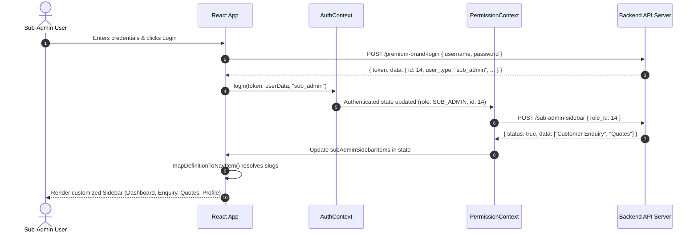
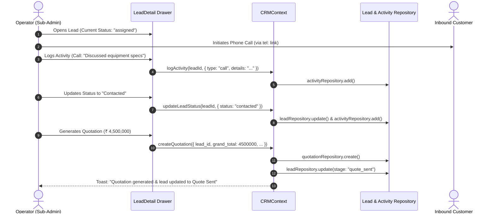

# EquipmentsDekho Partners Brand CRM — Complete System Documentation & Architectural Specification

> **Version:** 1.0.0  
> **System Architecture:** Single Page Application (SPA) — Enterprise B2B SaaS CRM & Partner Operations Portal  
> **Target Audience:** Engineering Team, Solution Architects, DevOps, Product Managers, QA Engineers, and Technical Onboarding  

---

## Table of Contents

1. [Executive Summary & System Purpose](#1-executive-summary--system-purpose)
2. [High-Level Architectural Overview](#2-high-level-architectural-overview)
3. [Technology Stack & Core Dependencies](#3-technology-stack--core-dependencies)
4. [Directory & Project File Hierarchy](#4-directory--project-file-hierarchy)
5. [Authentication, Session & Security Model](#5-authentication-session--security-model)
6. [Multi-Tier Role-Based Access Control (RBAC) & Dynamic Permissions](#6-multi-tier-role-based-access-control-rbac--dynamic-permissions)
7. [Dynamic Navigation & Route Guard Architecture](#7-dynamic-navigation--route-guard-architecture)
8. [CRM Operations Engine & Business Workflows](#8-crm-operations-engine--business-workflows)
   - [8.1 Leads Management & Unified Pipeline](#81-leads-management--unified-pipeline)
   - [8.2 Customer Enquiries Workflow](#82-customer-enquiries-workflow)
   - [8.3 Feature Equipment Quotation Requests](#83-feature-equipment-quotation-requests)
   - [8.4 Follow-ups & Reminders](#84-follow-ups--reminders)
   - [8.5 Activity Timeline & Customer History](#85-activity-timeline--customer-history)
9. [Territory Management & Auto-Assignment Algorithm](#9-territory-management--auto-assignment-algorithm)
10. [Sub-Admin Operations & Role Permission Matrix](#10-sub-admin-operations--role-permission-matrix)
11. [API Integration Layer & Network Architecture](#11-api-integration-layer--network-architecture)
12. [State Management & React Context Providers](#12-state-management--react-context-providers)
13. [Design System & Common Component Library](#13-design-system--common-component-library)
14. [Sequence & Data Flow Diagrams](#14-sequence--data-flow-diagrams)
15. [Environment Configuration & Deployment Guide](#15-environment-configuration--deployment-guide)
16. [Production Readiness & Optimization Recommendations](#16-production-readiness--optimization-recommendations)

---

## 1. Executive Summary & System Purpose

The **EquipmentsDekho Partners Brand Portal** is a high-performance, enterprise-grade B2B Customer Relationship Management (CRM) and operations application. It empowers heavy equipment manufacturers, brand partners, and authorized equipment distributors to manage inbound customer inquiries, quotation requests, multi-state sales territories, field executives (Sub-Admins), and multi-stage deal pipelines.

### Primary Objectives:
- **Centralized Inbound Demand Capture:** Seamlessly aggregate inquiries and quote requests originating from the EquipmentsDekho marketplace for specific brand portfolios.
- **Strict Role-Based Multi-Tenancy:** Provide discrete operational scopes for Brand Principals (**Admin**) versus Regional Operators (**Sub-Admins**).
- **Dynamic Permission Resolution:** Dynamically construct sidebar menus and functional capabilities on-the-fly based on server-side permission contracts without client rebuilds.
- **Territory-Controlled Workload Routing:** Restrict Sub-Admin visibility to assigned States and Cities, featuring automated workload-balanced lead dispatching with admin override safeguards.
- **Audit-Ready Lead Tracking:** Preserve chronological, tamper-resistant activity histories (calls, notes, meetings, quotation dispatches, and status transitions) for every lead.

---

## 2. High-Level Architectural Overview

The application follows a modern **Decoupled Client-Server SPA Architecture** built with React 19 and Vite 8, styled using Tailwind CSS v4.

```
                      +---------------------------------------+
                      |         EquipmentsDekho API           |
                      |   partners.equipmentsdekho.com/apis   |
                      +-------------------+-------------------+
                                          |
                                HTTP / REST (Bearer JWT)
                                          |
+-----------------------------------------v-----------------------------------------+
|                               PARTNERS BRAND CLIENT                               |
|                                                                                   |
|  +-----------------------------------------------------------------------------+  |
|  |                             App Layer & Providers                           |  |
|  |   ThemeProvider -> AuthProvider -> PermissionProvider -> CRMProvider        |  |
|  +-----------------------------------------------------------------------------+  |
|                                         |                                         |
|  +--------------------+-----------------+--------------------+------------------+  |
|  |                    |                                      |                  |  |
|  v                    v                                      v                  v  |
| +------------+  +-------------------+                 +---------------+  +-------+ |
| | Auth & RBAC|  | Routing & Guards  |                 | CRM Engine    |  | UI/UX | |
| | Context    |  | PrivateRoute      |                 | Leads Pipeline|  | Theme | |
| | Roles      |  | PermissionRoute   |                 | Auto-Assign   |  | Tables| |
| | Permissions|  | Dynamic Sidebar   |                 | Quotations    |  | Modals| |
| +------------+  +-------------------+                 +---------------+  +-------+ |
|        |                  |                                  |               |     |
|        +------------------+----------------------------------+---------------+     |
|                                         |                                         |
|  +--------------------------------------v--------------------------------------+  |
|  |                       Service & Repository Layer                            |  |
|  |  authApi | inquiryApi | productQuotation | subAdminService | crmRepository   |  |
|  +-----------------------------------------------------------------------------+  |
|                                         |                                         |
|  +--------------------------------------v--------------------------------------+  |
|  |                         Axios Network Client                                |  |
|  |          Request Auth Interceptor | Error Toast Deduplicator                 |  |
|  +-----------------------------------------------------------------------------+  |
+-----------------------------------------------------------------------------------+
```

---

## 3. Technology Stack & Core Dependencies

| Category | Library / Tool | Version | Technical Purpose & Value |
| :--- | :--- | :--- | :--- |
| **Runtime & Framework** | React | `^19.2.6` | Modern Concurrent Mode, optimized reconciliation, fine-grained state hooks |
| **DOM Engine** | React DOM | `^19.2.6` | Browser rendering target for React 19 |
| **Build Tool & Bundler**| Vite | `^8.0.12` | Lightning-fast ESM development server, Rollup production bundling |
| **Styling & Design** | Tailwind CSS | `^4.3.1` | Next-generation utility-first CSS engine with `@tailwindcss/vite` integration |
| **Client Routing** | React Router DOM | `^7.18.0` | Declarative client routing with nested layouts, history control, and URL search param hooks |
| **HTTP Client** | Axios | `^1.18.0` | Promise-based networking with interceptors for bearer tokens and unified error handling |
| **Form Handling** | React Hook Form | `^7.79.0` | High-performance uncontrolled form state with minimal re-renders |
| **Iconography** | Lucide React | `^1.21.0` | Comprehensive, consistent SVG icon set |
| **Notification Engine** | React Hot Toast | `^2.6.0` | Lightweight, non-intrusive toast notifications with global deduplication |
| **Select Components** | React Select | `^5.10.2` | Searchable, accessible multi-select and asynchronous dropdown controls |
| **Linting & Code Style**| ESLint + Plugins | `^10.3.0` | Strict linting for React hooks, refresh boundaries, and modern JS standards |

---

## 4. Directory & Project File Hierarchy

```
partners-brand/
├── .env                              # Base API environment configuration
├── .gitignore                        # Git exclusion rules
├── eslint.config.js                  # ESLint flat configuration
├── index.html                        # Application entry HTML container
├── package.json                      # Project dependencies, scripts, and engine metadata
├── tailwind.config.js                # Tailwind styling themes, fonts, and animation extensions
├── vite.config.js                    # Vite bundler, React plugin & Tailwind Vite plugin
└── src/
    ├── main.jsx                      # React 19 root bootstrap
    ├── App.jsx                       # Master Application component, provider composition & Toast config
    ├── index.css                     # Global Tailwind stylesheets and font definitions
    │
    ├── api/                          # HTTP Communication Engine
    │   ├── axios.js                  # Axios instance with request/response interceptors & auto-refresh/401 redirect
    │   └── apiRequest.js             # Resilient wrapper normalizing promises, payload parsing & error formats
    │
    ├── endPoints/                    # Network Configuration
    │   └── APIEndpoints.js           # Declarative mapping of backend API endpoints and HTTP methods
    │
    ├── services/                     # Business Logic & Backend Service Integrations
    │   ├── authApi.js                # Login, registration, profile fetch, and session logout
    │   ├── dashboardApi.js           # Real-time dashboard KPI metrics and activity counters
    │   ├── inquiryApi.js             # Customer inquiries pagination and retrieval
    │   ├── productQuotation.js       # Feature equipment quote requests
    │   ├── profile.js                # Brand profile update service (multipart/form-data)
    │   ├── premiumBrands.js          # Brand catalogue services
    │   ├── subAdminService.js        # Sub-Admin retrieval, role mapping, and normalization
    │   ├── subAdminPermissionService.js # Role permission assignment (POST /add-premium-brand-role-permission)
    │   ├── permissionManagementService.js # Permission definitions registry (create/edit/list)
    │   └── subAdminSidebarService.js # Sub-Admin permitted sidebar dynamic loader (POST /sub-admin-sidebar)
    │
    ├── repositories/                 # Data Access Layer & Abstraction
    │   ├── subAdminRepository.js     # API transport layer for Sub-Admin queries
    │   ├── subAdminPermissionRepository.js # API transport for permissions assignment
    │   ├── permissionManagementRepository.js # API transport for permission definitions
    │   └── local/                    # Local storage repository & memory mock cache
    │       └── crmRepository.js      # CRUD repository for Leads, Quotations, Customers, Activities & Team
    │
    ├── context/                      # React Context State Providers
    │   ├── AuthContext.jsx           # Global authentication state, JWT storage, role normalization & session check
    │   ├── PermissionContext.jsx     # Dynamic permissions loader for Admin and Sub-Admin roles
    │   ├── CRMContext.jsx            # Lead lifecycle state, territory visibility filter, auto-assigner, activities
    │   └── ThemeContext.jsx          # Dark / Light theme persistence and HTML class synchronizer
    │
    ├── hooks/                        # Custom Reusable React Hooks
    │   ├── useBrand.js               # Convenience hook extracting brand ID, brand name, and metadata
    │   ├── useDataTable.js           # Sorting, pagination, and multi-field search for tabular views
    │   ├── usePermissions.js         # Permission evaluations, module access checks, and territory validation
    │   ├── useSubAdmins.js           # Data-fetching hook managing Sub-Admin lists, loading, and error states
    │   └── useSubAdminPermissions.js # Sub-Admin permission assignment state, dirty checking & submit handler
    │
    ├── routes/                       # Routing Configuration
    │   └── AppRoutes.jsx             # Complete route hierarchy, public/private gates, backward-compatibility redirects
    │
    ├── layouts/                      # Layout Templates
    │   └── DashboardLayout.jsx       # Persistent responsive frame: Sidebar, TopHeader, and content Outlet
    │
    ├── components/                   # UI Component Ecosystem
    │   ├── common/                   # 30+ Atomic & Molecular Design System Components
    │   │   ├── AppErrorBoundary.jsx  # React Error Boundary catching unhandled UI render crashes
    │   │   ├── Avatar.jsx            # Fallback avatar generator with initial letters and role badges
    │   │   ├── Badge.jsx             # Universal indicator badge
    │   │   ├── Button.jsx            # Multi-variant button (primary, secondary, danger, ghost) with loading state
    │   │   ├── Checkbox.jsx          # Accessible custom checkbox control
    │   │   ├── ConfirmDialog.jsx     # Destructive action verification modal
    │   │   ├── DataTable.jsx         # Full-featured table with sorting, empty states, and pagination
    │   │   ├── Drawer.jsx            # Off-canvas slide-over drawer for detail views
    │   │   ├── EmptyState.jsx        # Graphic placeholder when zero records match filters
    │   │   ├── ErrorDialog.jsx       # Modal error alert
    │   │   ├── ErrorState.jsx        # In-page error banner with retry trigger
    │   │   ├── FilterBar.jsx         # Query bar with dropdown filters and reset actions
    │   │   ├── IconButton.jsx        # Icon-only accessible action button
    │   │   ├── Input.jsx             # Form text input with floating labels and error strings
    │   │   ├── LoadingState.jsx      # Spinner and loading state indicator
    │   │   ├── Modal.jsx             # Accessible modal dialogue with ESC key and backdrop dismissal
    │   │   ├── MultiSelect.jsx       # Multi-option selector
    │   │   ├── PageHeader.jsx        # Breadcrumb, page title, subtitle, and primary actions bar
    │   │   ├── Pagination.jsx        # Numeric page switcher with next/prev controls
    │   │   ├── PermissionTable.jsx   # Toggleable permission matrix for Sub-Admin configuration
    │   │   ├── PriorityBadge.jsx     # Visual priority tags (Hot, Warm, Cold)
    │   │   ├── SearchableSelect.jsx  # Typeahead searchable dropdown
    │   │   ├── SearchInput.jsx       # Instant search box with clear button
    │   │   ├── Select.jsx            # Native and styled select dropdown
    │   │   ├── Skeletons.jsx         # Card and table skeleton loaders preventing layout shifts
    │   │   ├── StatCard.jsx          # Dashboard KPI metric cards with trends and icons
    │   │   ├── StatusBadge.jsx       # Status badges with color-coded tokens
    │   │   ├── Switch.jsx            # Animated toggle switch for boolean settings
    │   │   ├── TableToolbar.jsx      # Table header with search, filters, export, and record count
    │   │   ├── Textarea.jsx          # Multiline expandable input
    │   │   └── UnderDevelopment.jsx  # Feature coming soon placeholder
    │   │
    │   ├── crm/                      # CRM Domain Components
    │   │   ├── ActivityTimeline.jsx  # Chronological log of calls, notes, quotes, and status changes
    │   │   ├── AssignmentSelector.jsx# Sub-Admin picker with territory match indicator & workload stats
    │   │   ├── LeadDetail.jsx        # Comprehensive 360-degree lead inspection slide-over drawer
    │   │   ├── LocationSelector.jsx  # State and City hierarchical picker
    │   │   └── TerritorySelector.jsx # Multi-state territory assigner with "All Cities" toggle
    │   │
    │   ├── guards/                   # Security & Navigation Guards
    │   │   ├── PermissionGate.jsx    # Conditional JSX renderer based on permission actions
    │   │   ├── PermissionRoute.jsx   # Route guard enforcing module permission or admin exclusivity
    │   │   ├── PrivateRoute.jsx      # Authentication guard redirecting unauthenticated users to /login
    │   │   └── PublicRoute.jsx       # Guest guard redirecting authenticated users to /dashboard
    │   │
    │   ├── layout/                   # Shell Layout Components
    │   │   ├── Sidebar.jsx           # Responsive dynamic sidebar supporting collapse and mobile drawer
    │   │   ├── TopHeader.jsx         # Sticky top navigation with brand badge, theme toggle & user menu
    │   │   ├── ThemeToggle.jsx       # Light/Dark mode toggle button
    │   │   └── UserMenu.jsx          # Current user card, role indicator, profile link, and logout button
    │   │
    │   └── permissions/              # Permission Management Components
    │       └── PermissionFormModal.jsx # Add/Edit modal for dynamic permission definitions
    │
    ├── pages/                        # View Pages & Route Containers
    │   ├── Login.jsx                 # Secure login page supporting brand admins and sub-admins
    │   ├── Register.jsx              # Brand partner registration page with GST and office validation
    │   ├── ForgotPassword.jsx        # Credential recovery interface
    │   ├── Dashboard.jsx             # Executive KPI analytics dashboard with recent activity widgets
    │   ├── CustomerEnquiry.jsx       # Inbound customer equipment inquiries table with drawer & CSV export
    │   ├── FeatureEquipmentQuotes.jsx# Product-specific quotation request registry with pipeline enrichments
    │   ├── Profile.jsx               # Brand Partner profile view and edit modal (multipart update)
    │   ├── NotFound.jsx              # Custom branded 404 page with return route
    │   │
    │   ├── crm/                      # CRM Management Pages
    │   │   ├── AllLeads.jsx          # Unified leads table with tab filters (All / Unassigned / My Leads)
    │   │   └── FollowUps.jsx         # Scheduled follow-up pipeline grouped by overdue, today & upcoming
    │   │
    │   ├── permissions/              # Permission Definition Pages
    │   │   └── PermissionManagement.jsx # Master dynamic permission registry (Admin only)
    │   │
    │   ├── reports/                  # Analytics & Reporting Pages
    │   │   └── CRMReports.jsx        # State-by-state demand distribution & operator performance metrics
    │   │
    │   └── subadmins/                # Sub-Admin Operations Pages
    │       ├── SubAdmins.jsx         # Sub-Admin roster with search, filter, and detail view mode
    │       ├── SubAdminDetail.jsx    # Sub-Admin profile view, assigned territories & performance stats
    │       └── SubAdminPermissions.jsx# Dynamic permission configuration matrix for specific Sub-Admin
    │
    ├── config/                       # Static & Dynamic System Configuration
    │   ├── activityTypes.js          # Activity categories (Call, Email, WhatsApp, Meeting, Note)
    │   ├── crmStatuses.js            # Standardized status tokens, badges, and lifecycle stages
    │   ├── locations.js              # Comprehensive list of Indian States and Major Industrial Cities
    │   ├── navigation.js             # Navigation section generator and dynamic route mapper
    │   └── permissions.js            # Centralized permissions and modules enum registry
    │
    ├── mock/                         # Seed Data Definitions
    │   └── crmInitialData.js         # Production schema baseline data structures
    │
    └── utils/                        # Pure Helper Functions & Algorithms
        ├── accessRules.js            # Territory match evaluation, record view/update check & eligibility engine
        ├── contactLinks.js           # Sanitized tel:, mailto:, and WhatsApp click-to-chat link generators
        ├── dateUtils.js              # Human-readable date and time formatters (Indian & ISO formats)
        ├── errorHandler.js           # API error payload parser extracting validation messages
        ├── exportCsv.js              # Client-side CSV generator and trigger download utility
        ├── formatters.js             # Currency formatting (₹ INR), phone number masks, role strings
        ├── permissionResolver.js     # Slug-to-module and slug-to-actions normalizer
        ├── roleUtils.js              # Strict user_type normalizer (ADMIN | SUB_ADMIN | null)
        └── statusConfig.js           # Color maps, icons, and label helpers for CRM statuses
```

---

## 5. Authentication, Session & Security Model

The authentication architecture enforces secure token handling, zero role assumptions, and automatic session verification.

```
       [ Client Browser ]                              [ Backend API ]
               |                                               |
  1. POST /premium-brand-login { username, password }          |
  ------------------------------------------------------------>|
               |                                               |
  2. Response { token: "jwt_...", data: { id, user_type: "admin" } }
  |<-----------------------------------------------------------|
               |
  3. Normalize role: normalizeUserType("admin") -> "ADMIN"
  4. Store localStorage.setItem("token", token)
  5. Store localStorage.setItem("user", canonicalUser)
  6. Axios Interceptor mounts token to all subsequent requests:
     Authorization: Bearer <token>
               |
  7. On App Mount / Refresh:
     GET /profile -------------------------------------------->|
     |<-- Valid Profile (Updates User in State) ---------------|
     OR
     |<-- 401 Unauthorized ------------------------------------|
               |
     401 Handler triggers:
     - Clear localStorage
     - Show "Session expired" toast
     - window.location.replace("/login")
```

### Key Security Safeguards:
1. **Explicit Role Normalization (`roleUtils.js`):**  
   The application **never** defaults an unrecognized or absent `user_type` to Admin. Supported types:
   - `"admin"` $\rightarrow$ `ROLES.ADMIN`
   - `"sub_admin"`, `"subadmin"`, `"sub-admin"` $\rightarrow$ `ROLES.SUB_ADMIN`
   - Any unknown string $\rightarrow$ `null` (Auth state rejected, user forced to login).
2. **Bearer Token Authorization:**  
   Attached via Axios request interceptor (`api/axios.js`). If no token exists, the header is omitted.
3. **Session Expiration Guard (HTTP 401):**  
   Any 401 response received by the interceptor automatically wipes stored credentials from `localStorage` and redirects the user to `/login` without looping.
4. **Multipart File Uploads:**  
   Registration and profile updates properly format data using `FormData` with `multipart/form-data` encoding to support document submissions and GST validations.

---

## 6. Multi-Tier Role-Based Access Control (RBAC) & Dynamic Permissions

The portal implements a **two-tier role hierarchy** combined with **fine-grained dynamic capability assignment**:

### 6.1 Role Definitions
- **Main Admin (`ADMIN`):**  
  - Complete visibility over all leads, inquiries, and quotes across all Indian states.
  - Can manage Sub-Admin accounts and assign operational territories.
  - Can define and edit global system permission items via `POST /premium-brand-add-permission` and `POST /premium-brand-edit-permission`.
  - Can assign permissions to Sub-Admins via `POST /add-premium-brand-role-permission`.
  - Can manually override lead assignments outside assigned territories.
  - Access to CRM Reports and analytics.
- **Sub-Admin (`SUB_ADMIN`):**  
  - Visibility is strictly restricted to assigned territories (States & Cities) or leads directly assigned to their user ID.
  - Sidebar navigation items are loaded dynamically via `POST /sub-admin-sidebar`.
  - Cannot access Sub-Admin management, global permissions configuration, or executive reports.

### 6.2 Permission Slug Normalization Engine (`permissionResolver.js`)
Backend APIs return human or slug strings (e.g., `"CustomerEnquiry"`, `"Quotes"`, `"Leads"`). The resolver cleanses and maps these strings to system module constants:

```javascript
// Sanitizes string by stripping non-alphanumeric characters
const clean = String(slug).trim().toLowerCase().replace(/[^a-z0-9]/g, "");

// Intelligent substring pattern matching
if (clean.includes("enquir") || clean.includes("inquir")) return MODULES.CRM_ENQUIRIES;
if (clean.includes("quote")  || clean.includes("quotation")) return MODULES.CRM_QUOTES;
if (clean.includes("lead")) return MODULES.CRM_LEADS;
if (clean.includes("follow")) return MODULES.CRM_FOLLOWUPS;
if (clean.includes("report")) return MODULES.REPORTS;
```

This ensures zero breakage even if backend engineers modify the casing or naming of permission tags on the server.

---

## 7. Dynamic Navigation & Route Guard Architecture

The navigation engine (`config/navigation.js` & `components/layout/Sidebar.jsx`) builds distinct menus for Admin and Sub-Admin accounts:

### Dynamic Sidebar Construction:
- **For Admin:**  
  Calls `POST /get-premium-brand-permissions` $\rightarrow$ Dynamically maps each active permission to recognized CRM route items $\rightarrow$ Appends fixed administrative modules (`Sub Admins`, `Permissions`, `Profile`).
- **For Sub-Admin:**  
  Calls `POST /sub-admin-sidebar` with `{ role_id: user.id }` $\rightarrow$ Evaluates permitted modules $\rightarrow$ Builds permitted CRM navigation items. Any unsupported or unrecognized slug is safely omitted without crashing the UI.

### Route Protection Matrix:

| Route Path | Module Guard | Allowed Roles | Guard Enforcement | Fallback Behavior |
| :--- | :--- | :--- | :--- | :--- |
| `/login`, `/register` | Guest Only | Unauthenticated | `PublicRoute` | Redirects to `/dashboard` if logged in |
| `/dashboard` | `MODULES.DASHBOARD` | Admin & Sub-Admin | `PrivateRoute` + `PermissionRoute` | Access granted |
| `/crm/leads` | `MODULES.CRM_LEADS` | Permitted Roles | `PermissionRoute` | Redirects to `/dashboard` if unauthorized |
| `/crm/enquiries` | `MODULES.CRM_ENQUIRIES`| Permitted Roles | `PermissionRoute` | Redirects to `/dashboard` if unauthorized |
| `/crm/quotes` | `MODULES.CRM_QUOTES` | Permitted Roles | `PermissionRoute` | Redirects to `/dashboard` if unauthorized |
| `/crm/follow-ups` | `MODULES.CRM_FOLLOWUPS`| Permitted Roles | `PermissionRoute` | Redirects to `/dashboard` if unauthorized |
| `/sub-admins` | `MODULES.TEAM` | **Admin Only** | `PermissionRoute(adminOnly)` | Access denied banner + redirect |
| `/permissions` | `MODULES.TEAM` | **Admin Only** | `PermissionRoute(adminOnly)` | Access denied banner + redirect |
| `/reports` | `MODULES.REPORTS` | **Admin Only** | `PermissionRoute(adminOnly)` | Access denied banner + redirect |
| `/profile` | `MODULES.PROFILE` | Admin & Sub-Admin | `PermissionRoute` | Editable if `profile:edit` permitted |

---

## 8. CRM Operations Engine & Business Workflows

### 8.1 Leads Management & Unified Pipeline (`AllLeads.jsx`)
The Leads module unifies all inbound prospective buyers into a centralized operational view:
- **Filtering Capabilities:** Instant search across Customer Name, Phone, Code, Equipment Type, City, and State. Filter by status (`new`, `assigned`, `contacted`, `quote_sent`, `won`, `lost`) and priority (`hot`, `warm`, `cold`).
- **Tabbed Views:**
  1. *All Leads:* Full dataset accessible to the user's role.
  2. *Unassigned Leads:* Leads awaiting Sub-Admin assignment (featuring quick-assign badges).
  3. *My Leads:* Fast filter displaying only records directly assigned to the logged-in user.
- **Exporting:** One-click CSV export respecting current search and filter criteria.

### 8.2 Customer Enquiries Workflow (`CustomerEnquiry.jsx`)
- Communicates directly with `POST /premium-brand-quotes-enquiry`.
- Displays real customer inquiries including contact names, phone numbers, state/city location, and inquiry messages.
- Features quick-action phone calling links (`tel:`) and view triggers opening the **LeadDetail Drawer**.

### 8.3 Feature Equipment Quotation Requests (`FeatureEquipmentQuotes.jsx`)
- Communicates with `POST /get-feature-equipment-quotes`.
- Merges raw quotation inquiries with CRM repository statuses to track quotation progress.
- Displays equipment specifications requested by buyers, pricing discussions, and associated dealer remarks.

### 8.4 Follow-ups & Reminders (`FollowUps.jsx`)
- Categorizes follow-ups into three urgency buckets:
  1. **Overdue:** Follow-up target date is in the past. Highlighted with red warning badges.
  2. **Today:** Follow-up scheduled for the current calendar date. Highlighted in orange.
  3. **Upcoming:** Future scheduled dates.
- Operators can log call notes and reschedule follow-up dates directly from the card.

### 8.5 Activity Timeline & Customer History (`ActivityTimeline.jsx` & `LeadDetail.jsx`)
Every lead features a slide-over 360-degree inspection drawer with four interactive tabs:
1. **Activity Timeline:** Interactive vertical timeline documenting all interactions (calls, meetings, notes, quotes generated, status changes, and assignments).
2. **Customer History:** Prior orders, lifetime value, and past inquiries from the same customer phone number.
3. **Log Activity:** Form to record a phone call, WhatsApp conversation, site visit, or internal note.
4. **Schedule Follow-up:** Date-picker and notes field to set the next follow-up milestone.

---

## 9. Territory Management & Auto-Assignment Algorithm

A core differentiator of this CRM is its **multi-tier geographic authorization engine** (`utils/accessRules.js`).

```
                              [ Inbound Lead Created ]
                                         |
                                         v
                     +---------------------------------------+
                     | Does Lead have State and City values? |
                     +-------------------+-------------------+
                                         |
                                         v
                     +---------------------------------------+
                     | Scan all Active Sub-Admins in Brand   |
                     +-------------------+-------------------+
                                         |
                                         v
      +---------------------------------------------------------------------+
      | Sub-Admin Match Criteria:                                           |
      | 1. Sub-Admin status === "active"                                    |
      | 2. Has permission "leads:view" AND "leads:update"                   |
      | 3. Territory Match:                                                 |
      |    - Sub-Admin territory state === Lead state                       |
      |    - Sub-Admin cities includes "ALL" OR includes Lead city          |
      +----------------------------------+----------------------------------+
                                         |
                     +-------------------v-------------------+
                     | Any Eligible Sub-Admins identified?   |
                     +---------+-------------------+---------+
                               |                   |
                              YES                  NO
                               |                   |
                               v                   v
      +----------------------------------+   +----------------------------------+
      | Calculate Active Workload:       |   | Mark as Unassigned Lead          |
      | (Count open leads where stage    |   | Notify Brand Admin in Dashboard  |
      |  is NOT 'won' and NOT 'lost')    |   +----------------------------------+
      +----------------+-----------------+
                       |
                       v
      +----------------------------------+
      | Select Candidate with Lowest     |
      | Open Workload (Least Burdened)   |
      +----------------+-----------------+
                       |
                       v
      +----------------------------------+
      | Assign Lead to Selected Sub-Admin|
      | Log Event in Activity Timeline   |
      | Toast Success Notification       |
      +----------------------------------+
```

### Manual Territory Override Safeguard:
If an Admin manually assigns a lead to an operator who does not cover the lead's state/city, the system triggers an **Override Confirmation Prompt**. Upon confirmation, the assignment is executed and explicitly tagged in the audit trail:
> *"Admin territory override assignment by [Admin Name]. Reason: Out-of-territory manual assignment confirmed."*

---

## 10. Sub-Admin Operations & Role Permission Matrix

Brand Admins have full lifecycle control over team members (`pages/subadmins/`):

### 10.1 Sub-Admin Account Management
- **Listing & Search:** Real-time query matching across username, email, phone, company, GST, and office address.
- **Account Registration:** Creates sub-admin credentials associated with the brand partner ID.
- **Status Toggle:** Instantly activate or suspend sub-admin accounts.

### 10.2 Role Permission Matrix (`SubAdminPermissions.jsx`)
Permissions are not hardcoded. The system renders an interactive matrix based on live dynamic definitions from `POST /get-premium-brand-permissions`:
- Toggling permissions marks the form as **dirty**.
- When saved, it formats the selected definitions into an array of canonical permission names:
  ```json
  POST /add-premium-brand-role-permission
  {
    "role_id": "12",
    "permission_name": [
      "Customer Enquiry",
      "Quotes",
      "Leads"
    ]
  }
  ```
- Sub-Admin accounts receive immediate update upon their next route access or refresh.

---

## 11. API Integration Layer & Network Architecture

### 11.1 Base Configuration
- **API Base URL:** Sourced from `import.meta.env.VITE_API_URL` (Default: `https://partners.equipmentsdekho.com/apis/api`).
- **Timeout:** 15,000 milliseconds (15s).
- **Default Headers:** `Accept: application/json`.

### 11.2 Endpoint Registry (`endPoints/APIEndpoints.js`)

| Key | Endpoint URL | Method | Content-Type | Functional Description |
| :--- | :--- | :--- | :--- | :--- |
| `login` | `/premium-brand-login` | POST | JSON | Authenticates user and returns JWT token + user profile |
| `register` | `/premium-brand-register` | POST | Multipart | Registers new brand partner with documents and GST |
| `profile` | `/profile` | POST | JSON | Retrieves currently authenticated profile details |
| `logout` | `/logout` | POST | JSON | Revokes backend session |
| `premiumBrandQuotesEnquiry` | `/premium-brand-quotes-enquiry` | POST | Multipart | Fetches paginated customer inquiries for brand |
| `getFeatureEquipmentQuotes` | `/get-feature-equipment-quotes` | POST | Multipart | Fetches equipment quotation requests |
| `update_Profile` | `/update-profile` | POST | Multipart | Updates brand details, contact info, and addresses |
| `getDashboardData` | `/get-dashboard-data` | POST | Multipart | Fetches summary metrics, counts, and recent records |
| `getSubAdmins` | `/get-subadmins` | POST | JSON | Retrieves all Sub-Admins under current brand |
| `getPremiumBrandPermissions`| `/get-premium-brand-permissions` | POST | JSON | Returns global dynamic permission definitions |
| `addPremiumBrandPermission` | `/premium-brand-add-permission` | POST | JSON | Creates a new dynamic permission definition |
| `editPremiumBrandPermission`| `/premium-brand-edit-permission`| POST | JSON | Edits an existing dynamic permission definition |
| `addPremiumBrandRolePermission`| `/add-premium-brand-role-permission`| POST| JSON | Assigns dynamic permission list to a Sub-Admin role |
| `subAdminSidebar` | `/sub-admin-sidebar` | POST | JSON | Returns permitted sidebar navigation items for role |

### 11.3 Error Interception & Toast Deduplication (`api/axios.js`)
The response interceptor handles HTTP errors with automatic toast ID generation to prevent spamming the user:
- **`400 Bad Request`:** Displays server error message.
- **`401 Unauthorized`:** Session invalidation, storage purge, login redirect.
- **`403 Forbidden`:** Displays "You are not authorized" warning.
- **`404 Not Found`:** Displays resource missing alert.
- **`422 Validation Error`:** Extracts first nested validation message from `errors` object.
- **`429 Rate Limited`:** Informs user to slow down requests.
- **`500+ Server Error`:** Generic server error notification.

---

## 12. State Management & React Context Providers

Application state is composed of four specialized React contexts wrapped at the root in `src/App.jsx`:

```
<BrowserRouter>
  <ThemeProvider>
    <AuthProvider>
      <PermissionProvider>
        <CRMProvider>
          <AppErrorBoundary>
            <AppRoutes />
          </AppErrorBoundary>
          <Toaster />
        </CRMProvider>
      </PermissionProvider>
    </AuthProvider>
  </ThemeProvider>
</BrowserRouter>
```

### Context Breakdown:
1. **`ThemeContext`:**  
   Manages `theme` (`"dark"` | `"light"`). Persists selection to `localStorage.getItem("theme")`. Toggles the `'dark'` CSS class on `document.documentElement`.
2. **`AuthContext`:**  
   Holds `token`, `user`, `role`, `isAdmin`, `isSubAdmin`, `isAuthenticated`, and `loading`. Provides `login()`, `logout()`, and `fetchProfile()` methods.
3. **`PermissionContext`:**  
   Manages dynamic definitions (`adminPermissionDefinitions`) for Admins and dynamic sidebar items (`subAdminSidebarItems`) for Sub-Admins.
4. **`CRMContext`:**  
   Maintains in-memory and local repository state for leads, quotations, customers, and team members. Handles territory-filtered visibility, assignment logic, stage updates, and activity logging.

---

## 13. Design System & Common Component Library

The application utilizes an enterprise component library built with Tailwind CSS v4, supporting both Light and Dark themes.

### Component Summary:
- **`DataTable`:** Supports column definitions, custom cell renderers, sorting by key, pagination footer, loading skeletons, and empty state fallbacks.
- **`Modal` & `Drawer`:** Accessible overlay components with Escape key handlers, focus traps, backdrop click dismissal, and enter/leave animations.
- **`ConfirmDialog`:** Dedicated confirmation dialogue for irreversible actions (e.g., lead deletion, out-of-territory override).
- **`FilterBar` & `TableToolbar`:** Modular search, dropdown filters, CSV download triggers, and total record counts.
- **`Skeletons`:** `CardSkeleton` and `TableSkeleton` preventing Cumulative Layout Shifts (CLS) while remote API calls execute.
- **`AppErrorBoundary`:** Top-level React error boundary displaying a graceful recovery view with an error reload button if any component throws an uncaught JavaScript exception.

---

## 14. Sequence & Data Flow Diagrams

### 14.1 Dynamic Sub-Admin Sidebar Loading Sequence



### 14.2 Lead Status Progression & Quotation Dispatch Flow



---

## 15. Environment Configuration & Deployment Guide

### 15.1 Environment Variables
Create a `.env` file in the root directory:

```ini
# EquipmentsDekho Partners Backend API URL (without trailing slash)
VITE_API_URL=https://partners.equipmentsdekho.com/apis/api
```

### 15.2 Development & Build Commands

```bash
# 1. Install dependencies
npm install

# 2. Start local development server with Hot Module Replacement (HMR)
npm run dev

# 3. Execute ESLint validation across codebase
npm run lint

# 4. Compile optimized production build (into dist/ folder)
npm run build

# 5. Preview production build locally
npm run preview

# 6. Run production preview accessible over local network (port 4000)
npm run start
```

### 15.3 Production Deployment Options
The compiled application in `dist/` consists of pure static HTML, CSS, JavaScript, and assets. It can be hosted on any static hosting platform or reverse proxy:
- **Nginx Configuration:**
  ```nginx
  server {
      listen 80;
      server_name partners.equipmentsdekho.com;
      root /var/www/partners-brand/dist;
      index index.html;

      location / {
          try_files $uri $uri/ /index.html;
      }

      location /assets/ {
          expires 1y;
          add_header Cache-Control "public, no-transform";
      }
  }
  ```
- **Docker Containerization:**
  ```dockerfile
  FROM node:20-alpine AS builder
  WORKDIR /app
  COPY package*.json ./
  RUN npm ci
  COPY . .
  RUN npm run build

  FROM nginx:alpine
  COPY --from=builder /app/dist /usr/share/nginx/html
  COPY nginx.conf /etc/nginx/conf.d/default.conf
  EXPOSE 80
  CMD ["nginx", "-g", "daemon off;"]
  ```

---

## 16. Production Readiness & Optimization Recommendations

1. **Code Splitting via Dynamic Imports (`React.lazy`):**  
   The current production build outputs a single vendor bundle of ~645 kB. It is recommended to implement route-level code splitting using `React.lazy` and `React.Suspense` for heavy pages (`CustomerEnquiry`, `FeatureEquipmentQuotes`, `CRMReports`).
2. **Offline Data Persistence:**  
   Currently, the CRM local repository synchronizes with memory and `localStorage`. For heavy enterprise usage, migrating client-side caches to **IndexedDB** (via Dexie.js or idb-keyval) will allow seamless offline operations.
3. **Automated End-to-End Testing:**  
   Integrate **Playwright** or **Cypress** to test critical user journeys:
   - Login $\rightarrow$ Dynamic sidebar verification.
   - Lead assignment $\rightarrow$ Out-of-territory override modal verification.
   - Quotation generation $\rightarrow$ Status update pipeline.
4. **WebSocket / Server-Sent Events (SSE) Real-Time Alerts:**  
   Implement a lightweight WebSocket or SSE client to notify logged-in operators immediately when a new customer enquiry or quote arrives for their assigned brand without requiring manual table refresh.

---

*Documentation compiled and verified against codebase v1.0.0. Maintained by EquipmentsDekho Engineering Team.*
