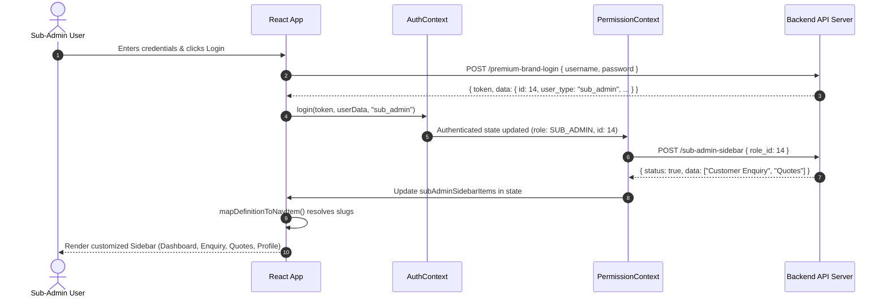
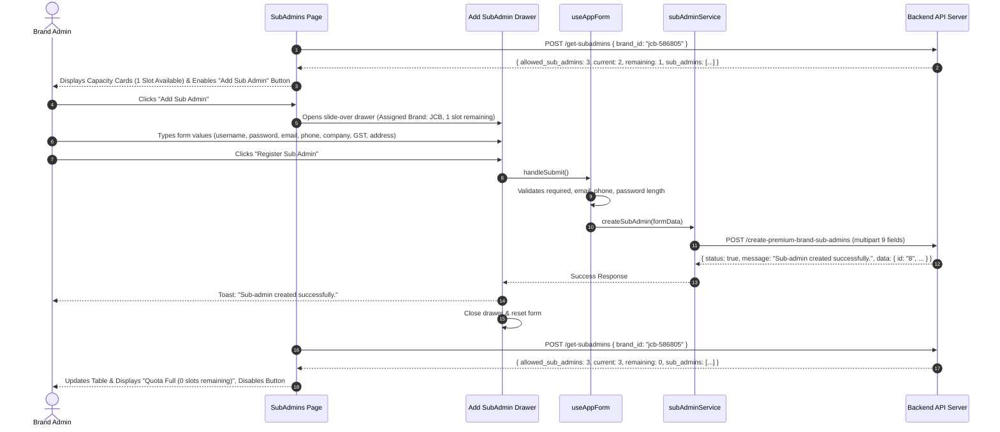
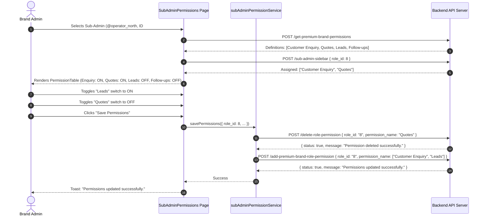
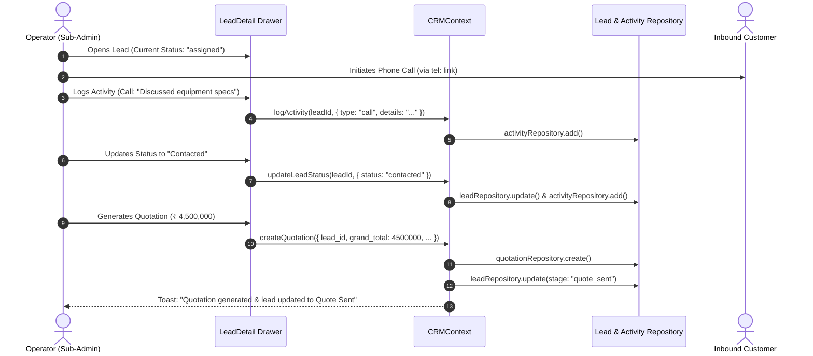

# EquipmentsDekho Partners Brand CRM — Complete System Documentation & Architectural Specification

> **Version:** 1.2.0 (Production Release)  
> **System Architecture:** Single Page Application (SPA) — Enterprise B2B SaaS CRM & Partner Operations Portal  
> **Target Audience:** Engineering Team, Solution Architects, DevOps, Product Managers, QA Engineers, and Technical Onboarding  
> **Last Updated:** November 2026  

---

## Table of Contents

1. [Executive Summary & System Purpose](#1-executive-summary--system-purpose)
2. [High-Level Architectural Overview](#2-high-level-architectural-overview)
3. [Technology Stack & Core Dependencies](#3-technology-stack--core-dependencies)
4. [Directory & Project File Hierarchy](#4-directory--project-file-hierarchy)
5. [Authentication, Session & Security Model](#5-authentication-session--security-model)
6. [Multi-Tier Role-Based Access Control (RBAC) & Permission Architecture](#6-multi-tier-role-based-access-control-rbac--permission-architecture)
   - [6.1 Role Definitions & Functional Scopes](#61-role-definitions--functional-scopes)
   - [6.2 Master Admin vs. Partner Brand Admin Governance Model](#62-master-admin-vs-partner-brand-admin-governance-model)
   - [6.3 Permission Slug Normalization Engine](#63-permission-slug-normalization-engine)
7. [Dynamic Navigation & Route Guard Architecture](#7-dynamic-navigation--route-guard-architecture)
   - [7.1 Dynamic Sub-Admin Sidebar Construction](#71-dynamic-sub-admin-sidebar-construction)
   - [7.2 Route Protection Matrix](#72-route-protection-matrix)
8. [CRM Operations Engine & Business Workflows](#8-crm-operations-engine--business-workflows)
   - [8.1 Leads Management & Unified Pipeline](#81-leads-management--unified-pipeline)
   - [8.2 Customer Enquiries Workflow](#82-customer-enquiries-workflow)
   - [8.3 Feature Equipment Quotation Requests](#83-feature-equipment-quotation-requests)
   - [8.4 Follow-ups & Reminders](#84-follow-ups--reminders)
   - [8.5 Activity Timeline & Customer History](#85-activity-timeline--customer-history)
9. [Territory Management & Auto-Assignment Algorithm](#9-territory-management--auto-assignment-algorithm)
10. [Sub-Admin Operations, Live Quota Limits & Permission Matrix](#10-sub-admin-operations-live-quota-limits--permission-matrix)
    - [10.1 Live Capacity Limits & Quota Architecture](#101-live-capacity-limits--quota-architecture)
    - [10.2 Create Premium Brand Sub-Admin Real API Integration](#102-create-premium-brand-sub-admin-real-api-integration)
    - [10.3 Slide-Over Drawer UI Architecture](#103-slide-over-drawer-ui-architecture)
    - [10.4 Sub-Admin Permission Enable/Disable Toggle Architecture](#104-sub-admin-permission-enabledisable-toggle-architecture)
    - [10.5 Master Admin vs. Sub-Admin Permission Boundaries](#105-master-admin-vs-sub-admin-permission-boundaries)
11. [Reusable Enterprise Form & Modal/Drawer System](#11-reusable-enterprise-form--modaldrawer-system)
    - [11.1 useAppForm Hook Architecture](#111-useappform-hook-architecture)
    - [11.2 Declarative Form & FormField Components](#112-declarative-form--formfield-components)
    - [11.3 PasswordInput with Accessible Visibility Toggle](#113-passwordinput-with-accessible-visibility-toggle)
    - [11.4 Slide-Over Drawer & Modal Focus Isolation](#114-slide-over-drawer--modal-focus-isolation)
    - [11.5 Root-Cause Resolution of Global Input Focus Stealing](#115-root-cause-resolution-of-global-input-focus-stealing)
12. [Global Dark Mode Table Architecture & Responsive Layout](#12-global-dark-mode-table-architecture--responsive-layout)
    - [12.1 Universal Dark Theme Surface Tokens for Table Headers](#121-universal-dark-theme-surface-tokens-for-table-headers)
    - [12.2 Sticky Headers with Backdrop Blur & Z-Index Stratification](#122-sticky-headers-with-backdrop-blur--z-index-stratification)
    - [12.3 Viewport Responsiveness & Overflow Prevention](#123-viewport-responsiveness--overflow-prevention)
13. [API Integration Layer & Network Architecture](#13-api-integration-layer--network-architecture)
    - [13.1 Base Configuration](#131-base-configuration)
    - [13.2 Centralized Endpoint Registry](#132-centralized-endpoint-registry)
    - [13.3 Error Interception & Toast Deduplication](#133-error-interception--toast-deduplication)
14. [State Management & React Context Providers](#14-state-management--react-context-providers)
15. [Design System & Common Component Library](#15-design-system--common-component-library)
16. [Sequence & Data Flow Diagrams](#16-sequence--data-flow-diagrams)
    - [16.1 Dynamic Sub-Admin Sidebar Loading Sequence](#161-dynamic-sub-admin-sidebar-loading-sequence)
    - [16.2 Sub-Admin Creation with Real-Time Quota Validation Sequence](#162-sub-admin-creation-with-real-time-quota-validation-sequence)
    - [16.3 Sub-Admin Permission Enable/Disable Toggle Sequence](#163-sub-admin-permission-enabledisable-toggle-sequence)
    - [16.4 Lead Status Progression & Quotation Dispatch Flow](#164-lead-status-progression--quotation-dispatch-flow)
17. [Environment Configuration & Deployment Guide](#17-environment-configuration--deployment-guide)
18. [Production Readiness & Optimization Recommendations](#18-production-readiness--optimization-recommendations)

---

## 1. Executive Summary & System Purpose

The **EquipmentsDekho Partners Brand Portal** is a high-performance, enterprise-grade B2B Customer Relationship Management (CRM) and operations application. It empowers heavy equipment manufacturers, brand partners (such as JCB, Caterpillar, Tata Hitachi, etc.), and authorized equipment distributors to manage inbound customer inquiries, quotation requests, multi-state sales territories, field executives (Sub-Admins), and multi-stage deal pipelines.

### Primary Objectives:
- **Centralized Inbound Demand Capture:** Seamlessly aggregate inquiries and quote requests originating from the EquipmentsDekho marketplace for specific brand portfolios.
- **Strict Role-Based Multi-Tenancy:** Provide discrete operational scopes for Brand Principals (**Admin**) versus Regional Operators (**Sub-Admins**).
- **Dynamic Permission Resolution:** Dynamically construct sidebar menus and functional capabilities on-the-fly based on server-side permission contracts without client rebuilds.
- **Dynamic Account Capacity & Quota Limits:** Query and enforce real-time Sub-Admin account quotas (`allowed_sub_admins`, `current_sub_admins`, `remaining_sub_admins`) directly from the live backend.
- **Production-Grade Form & Modal System:** Deliver a standardized, accessible form validation and slide-over drawer ecosystem aligned with the Master Admin panel design language.
- **Territory-Controlled Workload Routing:** Restrict Sub-Admin visibility to assigned States and Cities, featuring automated workload-balanced lead dispatching with admin override safeguards.
- **Audit-Ready Lead Tracking:** Preserve chronological, tamper-resistant activity histories (calls, notes, meetings, quotation dispatches, and status transitions) for every lead.

---

## 2. High-Level Architectural Overview

The application follows a modern **Decoupled Client-Server SPA Architecture** built with React 19 and Vite 8, styled using Tailwind CSS v4.

```
                      +---------------------------------------+
                      |         EquipmentsDekho API           |
                      |   partners.equipmentsdekho.com/apis   |
                      +-------------------+-------------------+
                                          |
                                HTTP / REST (Bearer JWT)
                                          |
+-----------------------------------------v-----------------------------------------+
|                               PARTNERS BRAND CLIENT                               |
|                                                                                   |
|  +-----------------------------------------------------------------------------+  |
|  |                             App Layer & Providers                           |  |
|  |   ThemeProvider -> AuthProvider -> PermissionProvider -> CRMProvider        |  |
|  +-----------------------------------------------------------------------------+  |
|                                         |                                         |
|  +--------------------+-----------------+--------------------+------------------+  |
|  |                    |                                      |                  |  |
|  v                    v                                      v                  v  |
| +------------+  +-------------------+                 +---------------+  +-------+ |
| | Auth & RBAC|  | Routing & Guards  |                 | CRM Engine    |  | UI/UX | |
| | Context    |  | PrivateRoute      |                 | Leads Pipeline|  | Theme | |
| | Roles      |  | PermissionRoute   |                 | Auto-Assign   |  | Tables| |
| | Permissions|  | Dynamic Sidebar   |                 | Quotations    |  | Drawer| |
| +------------+  +-------------------+                 +---------------+  +-------+ |
|        |                  |                                  |               |     |
|        +------------------+----------------------------------+---------------+     |
|                                         |                                         |
|  +--------------------------------------v--------------------------------------+  |
|  |                       Service & Repository Layer                            |  |
|  |  authApi | inquiryApi | productQuotation | subAdminService | crmRepository   |  |
|  |  subAdminSidebarService | subAdminPermissionService                         |  |
|  +-----------------------------------------------------------------------------+  |
|                                         |                                         |
|  +--------------------------------------v--------------------------------------+  |
|  |                         Axios Network Client                                |  |
|  |          Request Auth Interceptor | Error Toast Deduplicator                 |  |
|  +-----------------------------------------------------------------------------+  |
+-----------------------------------------------------------------------------------+
```

---

## 3. Technology Stack & Core Dependencies

| Category | Library / Tool | Version | Technical Purpose & Value |
| :--- | :--- | :--- | :--- |
| **Runtime & Framework** | React | `^19.2.6` | Modern Concurrent Mode, optimized reconciliation, fine-grained state hooks |
| **DOM Engine** | React DOM | `^19.2.6` | Browser rendering target for React 19 |
| **Build Tool & Bundler**| Vite | `^8.0.12` | Lightning-fast ESM development server, Rollup production bundling |
| **CSS Framework** | Tailwind CSS | `^4.3.1` | Utility-first styling with modern CSS `@theme` variables |
| **Routing Engine** | React Router DOM | `^7.18.0` | Declarative client-side routing, protected route layouts, and query state |
| **HTTP Transport** | Axios | `^1.18.0` | Promise-based HTTP client with request/response interceptors |
| **Icons Library** | Lucide React | `^1.21.0` | Accessible, tree-shakeable SVG UI icons |
| **Toast Engine** | React Hot Toast | `^2.6.0` | Non-blocking, accessible notifications with automatic deduplication |
| **Select Controls** | React Select | `^5.10.2` | Accessible typeahead search and multi-select dropdowns |
| **Linter & Rules** | ESLint & React Hooks | `^10.3.0` | Strict code quality enforcement and React 19 hook safety checks |

---

## 4. Directory & Project File Hierarchy

```text
src/
├── api/                                  # HTTP Network Client & Transport Configuration
│   ├── apiRequest.js                     # Unified network caller wrapper with error normalization
│   └── axios.js                          # Axios instance with auth interceptor & toast deduplication
│
├── config/                               # Static Constants, Navigation & Module Definitions
│   ├── crm.js                            # Lead stages, priority levels, activity types, inquiry types
│   ├── locations.js                      # Indian States and tier-1/tier-2/tier-3 cities catalog
│   ├── navigation.js                     # Dynamic sidebar builders for Admin and Sub-Admin
│   └── permissions.js                    # Core module constants, permission mappings & actions
│
├── endPoints/                            # Centralized Backend API Route Specifications
│   └── APIEndpoints.js                   # Registry of all 17 remote REST endpoints
│
├── services/                             # Business Logic & Orchestration Layer
│   ├── authApi.js                        # Login, Registration, Logout, Profile update service
│   ├── crmService.js                     # Lead management, assignment, activity logging, quotations
│   ├── inquiryApi.js                     # Customer inquiries fetch and status sync service
│   ├── permissionManagementService.js    # Master permission definitions service
│   ├── productQuotation.js               # Equipment quote requests fetch and status sync
│   ├── subAdminPermissionService.js      # Sub-admin role permission toggles (add/delete role permissions)
│   ├── subAdminService.js                # Sub-admin account creation, live capacity limits, list fetching
│   └── subAdminSidebarService.js         # Sub-admin dynamic sidebar items fetcher
│
├── repositories/                         # Data Access Layer & Caching
│   ├── inquiryRepository.js              # Remote API calls for customer enquiries
│   ├── productQuotationRepository.js     # Remote API calls for feature quotes
│   ├── subAdminPermissionRepository.js   # Remote API calls for role permissions (add/delete)
│   ├── subAdminRepository.js             # Remote API calls for sub-admins, creation & sidebar
│   ├── permissionManagementRepository.js # API transport for permission definitions
│   └── local/                            # Local storage repository & memory mock cache
│       └── crmRepository.js              # CRUD repository for Leads, Quotations, Customers, Activities
│
├── context/                              # React Context State Providers
│   ├── AuthContext.jsx                   # Global authentication state, JWT storage, role normalization
│   ├── PermissionContext.jsx             # Dynamic permissions loader for Admin and Sub-Admin roles
│   ├── CRMContext.jsx                    # Lead lifecycle state, territory visibility filter, auto-assigner
│   └── ThemeContext.jsx                  # Dark / Light theme persistence and HTML class synchronizer
│
├── hooks/                                # Custom Reusable React Hooks
│   ├── useAppForm.js                     # Production-ready form hook with validation, dirty & submission states
│   ├── useBrand.js                       # Convenience hook extracting brand ID, brand name, and metadata
│   ├── useDataTable.js                   # Sorting, pagination, and multi-field search for tabular views
│   ├── usePermissions.js                 # Permission evaluations, module access checks, and territory validation
│   ├── useSubAdmins.js                   # Live sub-admins data, dynamic limits (allowed, current, remaining)
│   └── useSubAdminPermissions.js         # Sub-admin permission toggle matrix state & submit handler
│
├── routes/                               # Routing Configuration
│   └── AppRoutes.jsx                     # Complete route hierarchy, public/private gates, backward-compatibility
│
├── layouts/                              # Layout Templates
│   └── DashboardLayout.jsx               # Persistent responsive frame: Sidebar, TopHeader, and content Outlet
│
├── components/                           # UI Component Ecosystem
│   ├── common/                           # Atomic & Molecular Design System Components
│   │   ├── AppErrorBoundary.jsx          # React Error Boundary catching unhandled UI render crashes
│   │   ├── Avatar.jsx                    # Fallback avatar generator with initial letters and role badges
│   │   ├── Badge.jsx                     # Universal indicator badge
│   │   ├── Button.jsx                    # Multi-variant button (primary, secondary, danger, outline, ghost)
│   │   ├── Checkbox.jsx                  # Accessible custom checkbox control
│   │   ├── ConfirmDialog.jsx             # Destructive action verification modal
│   │   ├── DataTable.jsx                 # Full-featured table with sorting, empty states, and pagination
│   │   ├── Drawer.jsx                    # Accessible slide-over drawer matching Admin Panel design pattern
│   │   ├── EmptyState.jsx                # Graphic placeholder when zero records match filters
│   │   ├── ErrorDialog.jsx               # Modal error alert
│   │   ├── ErrorState.jsx                # In-page error banner with retry trigger
│   │   ├── FilterBar.jsx                 # Query bar with dropdown filters and reset actions
│   │   ├── Form.jsx                      # Declarative schema-driven form layout container
│   │   ├── FormField.jsx                 # Polymorphic form field renderer with labels & error strings
│   │   ├── FormModal.jsx                 # Pre-packaged modal + form dialog integration
│   │   ├── IconButton.jsx                # Icon-only accessible action button
│   │   ├── Input.jsx                     # Form text input with focus rings and error strings
│   │   ├── LoadingState.jsx              # Spinner and loading state indicator
│   │   ├── Modal.jsx                     # Accessible modal dialogue with ESC key and backdrop dismissal
│   │   ├── MultiSelect.jsx               # Multi-option selector
│   │   ├── PageHeader.jsx                # Breadcrumb, page title, subtitle, and primary actions bar
│   │   ├── Pagination.jsx                # Numeric page switcher with next/prev controls
│   │   ├── PasswordInput.jsx             # Controlled password field with secure reveal toggle
│   │   ├── PermissionTable.jsx           # Clean Enable/Disable toggle table for sub-admin permissions
│   │   ├── PriorityBadge.jsx             # Visual priority tags (Hot, Warm, Cold)
│   │   ├── SearchableSelect.jsx          # Typeahead searchable dropdown
│   │   ├── SearchInput.jsx               # Instant search box with clear button
│   │   ├── Select.jsx                    # Native and styled select dropdown
│   │   ├── Skeletons.jsx                 # Card and table skeleton loaders preventing layout shifts
│   │   ├── StatCard.jsx                  # Dashboard KPI metric cards with trends and icons
│   │   ├── StatusBadge.jsx               # Status badges with color-coded tokens
│   │   ├── Switch.jsx                    # Animated toggle switch for boolean settings
│   │   ├── TableToolbar.jsx              # Table header with search, filters, export, and record count
│   │   ├── Textarea.jsx                  # Multiline expandable input
│   │   └── UnderDevelopment.jsx          # Feature coming soon placeholder
│   │
│   ├── crm/                              # CRM Domain Components
│   │   ├── ActivityTimeline.jsx          # Chronological log of calls, notes, quotes, and status changes
│   │   ├── AssignmentSelector.jsx        # Sub-Admin picker with territory match indicator & workload stats
│   │   ├── LeadDetail.jsx                # Comprehensive 360-degree lead inspection slide-over drawer
│   │   ├── LocationSelector.jsx          # State and City hierarchical picker
│   │   └── TerritorySelector.jsx         # Multi-state territory assigner with "All Cities" toggle
│   │
│   ├── guards/                           # Security & Navigation Guards
│   │   ├── PermissionGate.jsx            # Conditional JSX renderer based on permission actions
│   │   ├── PermissionRoute.jsx           # Route guard enforcing module permission or admin exclusivity
│   │   ├── PrivateRoute.jsx              # Authentication guard redirecting unauthenticated users to /login
│   │   └── PublicRoute.jsx               # Guest guard redirecting authenticated users to /dashboard
│   │
│   └── layout/                           # Shell Layout Components
│       ├── Sidebar.jsx                   # Responsive dynamic sidebar supporting collapse and mobile drawer
│       ├── TopHeader.jsx                 # Sticky top navigation with brand badge, theme toggle & user menu
│       ├── ThemeToggle.jsx               # Light/Dark mode toggle button
│       └── UserMenu.jsx                  # Current user card, role indicator, profile link, and logout button
│
└── pages/                                # View Pages & Route Containers
    ├── Login.jsx                         # Secure login page supporting brand admins and sub-admins
    ├── Register.jsx                      # Brand partner registration page with GST and office validation
    ├── ForgotPassword.jsx                # Credential recovery interface
    ├── Dashboard.jsx                     # Executive KPI analytics dashboard with recent activity widgets
    ├── CustomerEnquiry.jsx               # Inbound customer equipment inquiries table with drawer & CSV export
    ├── FeatureEquipmentQuotes.jsx        # Product-specific quotation request registry with pipeline enrichments
    ├── Profile.jsx                       # Brand Partner profile view and edit modal (multipart update)
    ├── NotFound.jsx                      # Custom branded 404 page with return route
    │
    ├── crm/                              # CRM Management Pages
    │   ├── AllLeads.jsx                  # Unified leads table with tab filters (All / Unassigned / My Leads)
    │   └── FollowUps.jsx                 # Scheduled follow-up pipeline grouped by overdue, today & upcoming
    │
    ├── reports/                          # Analytics & Reporting Pages
    │   └── CRMReports.jsx                # State-by-state demand distribution & operator performance metrics
    │
    └── subadmins/                        # Sub-Admin Operations Pages
        ├── SubAdmins.jsx                 # Sub-Admin roster with live capacity limits, Drawer, search & filters
        ├── SubAdminDetail.jsx            # Sub-admin profile view and territorial assignment summary
        └── SubAdminPermissions.jsx       # Sub-admin permission toggle matrix (Enable / Disable)
```

---

## 5. Authentication, Session & Security Model

The application enforces a rigorous JWT authentication flow with automatic session refresh and role normalization.

```text
[ Browser / Client ]                     [ EquipmentsDekho API Server ]
        |                                              |
        |--- POST /premium-brand-login --------------->|
        |    { username, password }                    |
        |                                              |
        |<-- 200 OK + JWT Token + User Object ---------|
        |    { token, data: { user_type, ... } }       |
        |                                              |
     Stores:
     - localStorage["auth_token"] = token
     - localStorage["user"] = JSON(user)
     - localStorage["user_role"] = "admin" | "sub_admin"
        |
        |--- Subsequent Requests (Bearer <token>) ---->|
        |                                              |
     OR
     |<-- 401 Unauthorized ----------------------------|
               |
     401 Handler triggers:
     - Clear localStorage
     - Show "Session expired" toast
     - window.location.replace("/login")
```

### Key Security Safeguards:
1. **Explicit Role Normalization (`roleUtils.js`):**  
   The application **never** defaults an unrecognized or absent `user_type` to Admin. Supported types:
   - `"admin"` $\rightarrow$ `ROLES.ADMIN`
   - `"sub_admin"`, `"subadmin"`, `"sub-admin"` $\rightarrow$ `ROLES.SUB_ADMIN`
   - Any unknown string $\rightarrow$ `null` (Auth state rejected, user forced to login).
2. **Bearer Token Authorization:**  
   Attached via Axios request interceptor (`api/axios.js`). If no token exists, the header is omitted.
3. **Session Expiration Guard (HTTP 401):**  
   Any 401 response received by the interceptor automatically wipes stored credentials from `localStorage` and redirects the user to `/login` without looping.
4. **Multipart File Uploads:**  
   Registration and profile updates properly format data using `FormData` with `multipart/form-data` encoding to support document submissions and GST validations.

---

## 6. Multi-Tier Role-Based Access Control (RBAC) & Permission Architecture

The portal implements a **two-tier role hierarchy** combined with **fine-grained dynamic capability assignment**:

### 6.1 Role Definitions & Functional Scopes

- **Main Admin (`ADMIN`):**  
  - Complete visibility over all leads, inquiries, and quotes across all Indian states.
  - Can manage Sub-Admin accounts and assign operational territories.
  - Monitors real-time Sub-Admin capacity limits (`allowed_sub_admins`, `current_sub_admins`, `remaining_sub_admins`).
  - Registers new Sub-Admins via `POST /create-premium-brand-sub-admins`.
  - Enables or Disables Sub-Admin permissions using toggles via `POST /add-role-permission` and `POST /delete-role-permission`.
  - Can manually override lead assignments outside assigned territories.
  - Access to CRM Reports and analytics.

- **Sub-Admin (`SUB_ADMIN`):**  
  - Visibility is strictly restricted to assigned territories (States & Cities) or leads directly assigned to their user ID.
  - Sidebar navigation items are loaded dynamically via `POST /sub-admin-sidebar`.
  - Cannot access Sub-Admin management, global permissions configuration, or executive reports.
  - Leads management, enquiry interaction, follow-up scheduling, and quotation dispatching.

### 6.2 Master Admin vs. Partner Brand Admin Governance Model

An essential architectural boundary is maintained between **Master Admin** (Equipments Dekho Super Admin) and **Partner Brand Admin** (e.g. JCB Admin):

1. **Permission Definitions Governance (Master Admin Only):**  
   - Master Admin alone possesses the authority to create, rename, or permanently delete global permission definitions (`/premium-brand-add-permission`, `/premium-brand-edit-permission`).
   - Individual Brand Admins cannot alter the catalog of available permissions.
   - Consequently, the global `/permissions` route has been **disabled** in the Partner Brand Admin portal and automatically redirects to `/sub-admins`.

2. **Permission Assignment Governance (Partner Brand Admin):**  
   - Partner Brand Admins configure permissions on a per-sub-admin basis (`/sub-admins?view=access`).
   - Permissions are presented as **Enable / Disable toggle switches** rather than delete buttons.
   - Enabling a permission calls `POST /add-role-permission` (or bulk `POST /add-premium-brand-role-permission`).
   - Disabling a permission calls `POST /delete-role-permission` with `{ role_id, permission_name }`.
   - Permissions are never permanently destroyed from the catalog; they are only detached from the Sub-Admin's role.

### 6.3 Permission Slug Normalization Engine (`permissionResolver.js`)

Backend APIs return human or slug strings (e.g., `"Customer Enquiry"`, `"Quotes"`, `"Leads"`). The resolver cleanses and maps these strings to system module constants:

```javascript
// Sanitizes string by stripping non-alphanumeric characters
const clean = String(slug).trim().toLowerCase().replace(/[^a-z0-9]/g, "");

// Intelligent substring pattern matching
if (clean.includes("enquir") || clean.includes("inquir")) return MODULES.CRM_ENQUIRIES;
if (clean.includes("quote")  || clean.includes("quotation")) return MODULES.CRM_QUOTES;
if (clean.includes("lead")) return MODULES.CRM_LEADS;
if (clean.includes("follow")) return MODULES.CRM_FOLLOWUPS;
if (clean.includes("report")) return MODULES.REPORTS;
```

This guarantees that variations in casing, spacing, or backend naming conventions never break navigation or route guards.

---

## 7. Dynamic Navigation & Route Guard Architecture

The navigation engine (`config/navigation.js` & `components/layout/Sidebar.jsx`) dynamically constructs menus tailored to the user's role and assigned permissions.

### 7.1 Dynamic Sub-Admin Sidebar Construction

- **For Admin:**  
  Calls `POST /get-premium-brand-permissions` $\rightarrow$ Dynamically maps each active permission to recognized CRM route items $\rightarrow$ Appends fixed administrative modules (`Sub Admins`, `Reports`, `Profile`).
- **For Sub-Admin:**  
  Calls `POST /sub-admin-sidebar` with `{ role_id: user.id }` $\rightarrow$ Receives permitted strings $\rightarrow$ Builds permitted CRM navigation items. Unpermitted items are omitted from the sidebar.

### 7.2 Route Protection Matrix

| Route Path | Module Guard | Allowed Roles | Guard Enforcement | Fallback Behavior |
| :--- | :--- | :--- | :--- | :--- |
| `/login`, `/register` | Guest Only | Unauthenticated | `PublicRoute` | Redirects to `/dashboard` if logged in |
| `/dashboard` | `MODULES.DASHBOARD` | Admin & Sub-Admin | `PrivateRoute` + `PermissionRoute` | Access granted |
| `/crm/leads` | `MODULES.CRM_LEADS` | Permitted Roles | `PermissionRoute` | Redirects to `/dashboard` if unauthorized |
| `/crm/enquiries` | `MODULES.CRM_ENQUIRIES`| Permitted Roles | `PermissionRoute` | Redirects to `/dashboard` if unauthorized |
| `/crm/quotes` | `MODULES.CRM_QUOTES` | Permitted Roles | `PermissionRoute` | Redirects to `/dashboard` if unauthorized |
| `/crm/follow-ups` | `MODULES.CRM_FOLLOWUPS`| Permitted Roles | `PermissionRoute` | Redirects to `/dashboard` if unauthorized |
| `/sub-admins` | `MODULES.TEAM` | **Admin Only** | `PermissionRoute(adminOnly)` | Access denied banner + redirect |
| `/permissions` | `MODULES.TEAM` | **Admin Only** | Redirect to `/sub-admins` | Controlled centrally by Master Admin |
| `/reports` | `MODULES.REPORTS` | **Admin Only** | `PermissionRoute(adminOnly)` | Access denied banner + redirect |
| `/profile` | `MODULES.PROFILE` | Admin & Sub-Admin | `PermissionRoute` | Editable if `profile:edit` permitted |

---

## 8. CRM Operations Engine & Business Workflows

### 8.1 Leads Management & Unified Pipeline (`AllLeads.jsx`)
- **Filtering Capabilities:** Instant search across Customer Name, Phone, Code, Equipment Type, City, and State. Filter by status (`new`, `assigned`, `contacted`, `quote_sent`, `won`, `lost`) and priority (`hot`, `warm`, `cold`).
- **Tabbed Views:**
  1. *All Leads:* Full dataset accessible to the user's role.
  2. *Unassigned Leads:* Leads awaiting Sub-Admin assignment (featuring quick-assign badges).
  3. *My Leads:* Fast filter displaying only records directly assigned to the logged-in user.
- **Exporting:** One-click CSV export respecting current search and filter criteria.

### 8.2 Customer Enquiries Workflow (`CustomerEnquiry.jsx`)
- Communicates directly with `POST /premium-brand-quotes-enquiry`.
- Displays real customer inquiries including contact names, phone numbers, state/city location, and inquiry messages.
- Features quick-action phone calling links (`tel:`) and view triggers opening the **LeadDetail Drawer**.

### 8.3 Feature Equipment Quotation Requests (`FeatureEquipmentQuotes.jsx`)
- Communicates with `POST /get-feature-equipment-quotes`.
- Merges raw quotation inquiries with CRM repository statuses to track quotation progress.
- Displays equipment specifications requested by buyers, pricing discussions, and associated dealer remarks.

### 8.4 Follow-ups & Reminders (`FollowUps.jsx`)
- Categorizes follow-ups into three urgency buckets:
  1. **Overdue:** Follow-up target date is in the past. Highlighted with red warning badges.
  2. **Today:** Follow-up scheduled for the current calendar date. Highlighted in orange.
  3. **Upcoming:** Future scheduled dates.
- Operators can log call notes and reschedule follow-up dates directly from the card.

### 8.5 Activity Timeline & Customer History (`ActivityTimeline.jsx` & `LeadDetail.jsx`)
Every lead features a slide-over 360-degree inspection drawer with four interactive tabs:
1. **Activity Timeline:** Interactive vertical timeline documenting all interactions (calls, meetings, notes, quotes generated, status changes, and assignments).
2. **Customer History:** Prior orders, lifetime value, and past inquiries from the same customer phone number.
3. **Log Activity:** Form to record a phone call, WhatsApp conversation, site visit, or internal note.
4. **Schedule Follow-up:** Date-picker and notes field to set the next follow-up milestone.

---

## 9. Territory Management & Auto-Assignment Algorithm

A core differentiator of this CRM is its **multi-tier geographic authorization engine** (`utils/accessRules.js`).

```
                              [ Inbound Lead Created ]
                                         |
                                         v
                     +---------------------------------------+
                     | Does Lead have State and City values? |
                     +-------------------+-------------------+
                                         |
                                         v
                     +---------------------------------------+
                     | Scan all Active Sub-Admins in Brand   |
                     +-------------------+-------------------+
                                         |
                                         v
      +---------------------------------------------------------------------+
      | Sub-Admin Match Criteria:                                           |
      | 1. Sub-Admin status === "active"                                    |
      | 2. Has permission "leads:view" AND "leads:update"                   |
      | 3. Territory Match:                                                 |
      |    - Sub-Admin territory state === Lead state                       |
      |    - Sub-Admin cities includes "ALL" OR includes Lead city          |
      +----------------------------------+----------------------------------+
                                         |
                     +-------------------v-------------------+
                     | Any Eligible Sub-Admins identified?   |
                     +---------+-------------------+---------+
                               |                   |
                              YES                  NO
                               |                   |
                               v                   v
      +----------------------------------+   +----------------------------------+
      | Calculate Active Workload:       |   | Mark as Unassigned Lead          |
      | (Count open leads where stage    |   | Notify Brand Admin in Dashboard  |
      |  is NOT 'won' and NOT 'lost')    |   +----------------------------------+
      +----------------+-----------------+
                       |
                       v
      +----------------------------------+
      | Select Candidate with Lowest     |
      | Open Workload (Least Burdened)   |
      +----------------+-----------------+
                       |
                       v
      +----------------------------------+
      | Assign Lead to Selected Sub-Admin|
      | Log Event in Activity Timeline   |
      | Toast Success Notification       |
      +----------------------------------+
```

### Manual Territory Override Safeguard:
If an Admin manually assigns a lead to an operator who does not cover the lead's state/city, the system triggers an **Override Confirmation Prompt**. Upon confirmation, the assignment is executed and explicitly tagged in the audit trail:
> *"Admin territory override assignment by [Admin Name]. Reason: Out-of-territory manual assignment confirmed."*

---

## 10. Sub-Admin Operations, Live Quota Limits & Permission Matrix

The Sub-Admin Management module (`pages/subadmins/SubAdmins.jsx`) has been upgraded to a production-grade operations suite featuring live account limits, slide-over drawer registration, and granular toggle controls.

### 10.1 Live Capacity Limits & Quota Architecture

The backend endpoint `POST /get-subadmins` returns dynamic capacity fields inside the `data` payload:

```json
{
  "status": true,
  "message": "Sub Admins fetched successfully.",
  "data": {
    "brand_id": "jcb-586805",
    "brand_name": "jcb",
    "allowed_sub_admins": 3,
    "current_sub_admins": 2,
    "remaining_sub_admins": 1,
    "sub_admins": [ ... ]
  }
}
```

The application renders three **Real-Time Account Capacity Summary Cards**:
1. **Allowed Sub Admins (`allowed_sub_admins`):** Maximum permitted Sub-Admin accounts allocated to this brand.
2. **Current Sub Admins (`current_sub_admins`):** Current count of active registered Sub-Admin accounts.
3. **Remaining Sub Admins (`remaining_sub_admins`):** Remaining available account slots, with a dynamic color-coded badge:
   - When $> 0$: Emerald `"Available"` badge showing remaining slots.
   - When $\le 0$: Slate `"Quota Full"` badge indicating capacity has been exhausted.

#### UI Quota Enforcement:
- When `remaining_sub_admins <= 0`, the primary **"Add Sub Admin"** button is automatically disabled, displaying a limit warning badge (`"Limit reached (X max)"`) and a helpful tooltip.
- Attempts to trigger account creation when the limit is reached produce a non-blocking toast warning: *"Brand has reached its Sub Admin account limit. 0 slots remaining."*

### 10.2 Create Premium Brand Sub-Admin Real API Integration

Endpoint: `POST https://partners.equipmentsdekho.com/apis/api/create-premium-brand-sub-admins`

Sub-Admin account creation uses real backend API persistence without local mocking. The request submits `multipart/form-data` with all 9 canonical fields:

```text
brand_id:         Authenticated Brand ID (e.g., "jcb-586805")
brand_name:       Authenticated Brand Name (e.g., "JCB")
username:         User-specified login username (e.g., "operator_north")
password:         User-entered password (min. 6 characters)
company_name:     Regional office or branch name (e.g., "Demo JCB")
office_address:   Physical branch address (e.g., "New Delhi")
phone_no:         Contact telephone number (e.g., "9721400000")
gst:              GST identification number (e.g., "07AAAAA0000A1Z5")
email:            Official email address (e.g., "operator@demo.com")
```

#### Successful Response Handling:
```json
{
  "status": true,
  "message": "Sub-admin created successfully.",
  "data": {
    "id": "7",
    "brand_id": "jcb-586805",
    "brand_name": "JCB",
    "username": "operator_north",
    "company_name": "Demo JCB",
    "office_address": "New Delhi",
    "phone_no": "9721400000",
    "gst": "07AAAAA0000A1Z5",
    "email": "operator@demo.com",
    "allowed_sub_admins": 3,
    "current_sub_admins": 3,
    "remaining_sub_admins": 0
  }
}
```
Upon successful creation:
1. Displays success toast notification.
2. Closes the slide-over drawer and resets form values.
3. Automatically triggers `fetchSubAdmins(brandId)` to synchronize table records and live capacity limits.

### 10.3 Slide-Over Drawer UI Architecture

To achieve 100% visual and interactive parity with the Master Admin panel (`PartnerAdminDrawer.jsx`), the Add Sub-Admin interface utilizes a **slide-over Drawer** (`Drawer.jsx`):
- **Dimensions & Transition:** `w-full sm:w-[500px] md:w-[560px]`, sliding in smoothly from the right with a backdrop blur overlay (`bg-slate-950/60 backdrop-blur-xs`).
- **Assigned Brand Identity Card:** Displays a prominent brand icon, active brand name, and monospace Brand ID badge (`activeBrandId`).
- **Capacity Indicator Banner:** Renders a clean status banner inside the drawer informing the admin of remaining available slots.
- **Contextual Input Icons:** Each form input is equipped with a distinct Lucide icon (`User`, `Lock`, `Mail`, `Phone`, `Building`, `FileText`, `MapPin`).
- **Sticky Actions Footer:** Persistent bottom action bar housing the `Cancel` outline button and `Register Sub Admin` primary button with built-in loading spinner.

### 10.4 Sub-Admin Active / Inactive Status Management

The portal integrates live status toggling for Sub-Admin accounts using the remote API:

- **Fetch Endpoint:** `POST /get-subadmins`
  - In the production response, the `sub_admins` array returns direct string statuses: `"status": "Active"` or `"status": "Inactive"`.
  - The integration maintains full backward compatibility for numeric codes (`1` / `0`), string codes (`"1"` / `"0"`), and optional `status_text` (`"Active"`, `"Deactive"`, `"Inactive"`).
- **Update Endpoint:** `POST /update-sub-admin-status`
- **Request Parameters:**
  ```json
  {
    "id": 4,
    "status": 1
  }
  ```
  *(Send `status: 0` for deactivation, `status: 1` for activation)*
- **Response Handling:**
  ```json
  {
    "status": true,
    "message": "Sub-admin activated successfully.",
    "data": {
      "id": "4",
      "brand_id": "jcb-586805",
      "brand_name": "JCB",
      "username": "demoo",
      "status": 1,
      "status_text": "Active"
    }
  }
  ```
- **Dynamic Status Normalization (`src/utils/subAdminStatus.js`):**
  - Handles string statuses (`"Active"` / `"Inactive"`, case-insensitively with whitespace trimming) as well as legacy numeric/string codes (`1` / `0`, `"1"` / `"0"`).
  - Explicitly maps `"Active"` $\rightarrow$ `isActive: true`, `numericStatus: 1`, label: `"Active"`, color: Emerald.
  - Explicitly maps `"Inactive"` / `"Deactive"` $\rightarrow$ `isActive: false`, `numericStatus: 0`, label: `"Inactive"` (or `"Deactive"` if provided as such), color: Slate.
  - Unexpected or missing values (`null`, `undefined`, `""`, unrecognized strings) resolve to `isActive: null`, `numericStatus: null`, label: `"Unknown"`, color: Amber (never assumed active).
- **UI Interaction & Concurrency Control:**
  - Dedicated **Status** column in the Sub-Admins table featuring an animated `Switch` control with status dot and label.
  - Per-row update tracking via `updatingSubAdminIds` (Set) preventing duplicate clicks or race conditions on the same row while allowing independent toggling across different rows.
  - Click events on the switch call `e.stopPropagation()` so row expansion / detail navigation is not inadvertently triggered.
  - Live status reflection in `SubAdminDetail.jsx` (header badge & overview row with activation/deactivation button) and `SubAdminPermissions.jsx` (identity summary card).
  - Proper rollback on network/server failure: the previous status is retained and the backend error message is displayed in a toast.

### 10.5 Sub-Admin Permission Enable/Disable Toggle Architecture

The Sub-Admin Permissions interface (`SubAdminPermissions.jsx` & `PermissionTable.jsx`) adopts a **Clean Enable / Disable Toggle Pattern**:

1. **Dynamic Permission Definitions (`GET /get-premium-brand-permissions`):**  
   Fetches global system permissions (e.g., Customer Enquiry, Quotes, Leads, Follow-ups, Reports).
2. **Current Sub-Admin Permissions (`POST /sub-admin-sidebar`):**  
   Retrieves currently assigned permission strings for the sub-admin's `role_id`.
3. **Toggle Controls:**  
   Each permission is rendered with its contextual icon, human title, slug identifier, and a clean **ON / OFF toggle switch** (`Switch.jsx`).
4. **Differential Update Execution (`subAdminPermissionService.savePermissions`):**  
   When the admin clicks **Save Permissions**:
   - Compares current toggle state against original permissions.
   - For permissions toggled **OFF**: Executes `POST /delete-role-permission` with `{ role_id, permission_name }`.
   - For permissions toggled **ON**: Executes `POST /add-premium-brand-role-permission` with `{ role_id, permission_name: [...] }`.
   - Displays success notification and updates dirty tracking state.

### 10.6 Master Admin vs. Sub-Admin Permission Boundaries

- **No Delete Action in Sub-Admin Screen:** Deleting permissions from the system is permanently restricted to Master Admin. Sub-Admin management allows only enabling or disabling access.
- **Disabled `/permissions` Route:** Navigating to `/permissions` or `/permission-management` automatically redirects the user to `/sub-admins`.

### 10.7 Sub-Admin Activity Tracking with Dedicated Demonstration Data (`subAdminActivityDemoData.js`)

While backend audit APIs are under development, the Sub-Admin Management module implements a clean, demonstration-ready **Activity History** module:
- **Strict Role-Based Access:**
  - **Primary Brand Admin (`role === "ADMIN"`):** Can access the Activity History tab and review Sub-Admin activities.
  - **Sub-Admin (`role === "SUB_ADMIN"`):** Completely blocked from viewing Activity History, its navigation tab, its data, and management controls.
- **2-Tab Streamlined Navigation:**
  - Tab 1: **Sub Admins** — Real-time quota capacity cards, operators directory table, slide-over Add Sub Admin drawer, Edit, Delete, Toggle Status, and Password Reset.
  - Tab 2: **Activity History** — Simplified single-view chronological log of administrative operations.
- **Subtle "DEMO DATA" Indicator:**
  - The Activity History tab displays a visible but non-intrusive warning notice:  
    `[DEMO DATA] Frontend preview using fictional activity records. Real server audit logging will integrate once backend endpoints are available.`
- **Tracked Operations (Strictly the 6 Business-Required Types):**
  1. `ADD`: Sub-Admin account created (Badge: **Emerald Green**).
  2. `EDIT`: Sub-Admin profile updated (Badge: **Blue**).
  3. `DELETE`: Sub-Admin deleted (Badge: **Red**).
  4. `ACTIVATE`: Sub-Admin account activated (Badge: **Emerald Green**).
  5. `DEACTIVATE`: Sub-Admin account deactivated (Badge: **Slate Gray**).
  6. `PERMISSION_CHANGE`: Sub-Admin permissions updated (Badge: **Purple**).
- **Dedicated Demonstration Dataset (`src/data/subAdminActivityDemoData.js`):**
  - Uses fictional demonstration identities (`demo_operator_north`, `demo_operator_west`, `demo_operator_south`, `demo_operator_temp`).
  - Standardized schema: `{ id, subAdminId, subAdminUsername, action, description, performedBy, createdAt, isDemo: true }`.
  - Kept completely separate from API services, repositories, and production endpoints (`/get-subadmins`).
  - Never pollutes localStorage or production requests with fake entries.
- **Dynamic Summary Counters (`subAdminActivityService.getActivitySummary`):**
  - **Total Activities:** Total valid activity records.
  - **Sub-Admins Added:** Count of `ADD` activities.
  - **Profile Updates:** Count of `EDIT` activities.
  - **Status Changes:** Combined count of `ACTIVATE` and `DEACTIVATE` events.
  - **Permission Changes:** Count of `PERMISSION_CHANGE` events.
  *(Calculated dynamically from the available activity dataset, never hardcoded).*
- **Activity Table Columns:**
  1. **Date & Time:** Formatted timestamp (`MMM dd, yyyy HH:mm`).
  2. **Sub-Admin:** Operator `@username` with initial avatar.
  3. **Action:** Consistent color-coded badges (`ADD`, `EDIT`, `DELETE`, `ACTIVATE`, `DEACTIVATE`, `PERMISSION_CHANGE`).
  4. **Description:** Meaningful action summaries.
  5. **Performed By:** Identity of the Brand Administrator.
- **Focused Filters:**
  - Search by Sub-Admin username.
  - Action Type dropdown filter (`ALL`, `ADD`, `EDIT`, `DELETE`, `ACTIVATE`, `DEACTIVATE`, `PERMISSION_CHANGE`).
  - Reset Filters button.
- **Empty State:**
  - When no records match filters, an intuitive empty state is displayed with a `Clear Filters` button.

### 10.8 Future API Integration Readiness & Pending Backend Contract

The frontend activity service (`subAdminActivityService.js`) maintains a clean, decoupled data contract:
- When the backend team deploys the real audit endpoint, `subAdminActivityService.getActivities()` will directly fetch from the remote endpoint instead of `subAdminActivityDemoData.js`.
- The `isDemoMode` flag will switch to `false`, removing the `DEMO DATA` banner without requiring any rewrite of `SubAdminActivityHistory.jsx`.

#### Pending Backend API Specification:
- **Endpoint:** `POST /get-subadmin-activities` (or `POST /get-subadmin-audit-logs`)
- **Headers:** `Authorization: Bearer <token>`
- **Request Payload:**
  ```json
  {
    "brand_id": "jcb-586805",
    "limit": 50,
    "page": 1,
    "action_type": "ALL"
  }
  ```
- **Expected Response Contract:**
  ```json
  {
    "status": true,
    "message": "Sub-admin activities fetched successfully.",
    "data": {
      "total": 6,
      "activities": [
        {
          "id": 101,
          "brand_id": "jcb-586805",
          "sub_admin_id": 6,
          "sub_admin_name": "jcbsubadmin",
          "action_type": "ACTIVATE",
          "description": "Sub Admin account activated.",
          "performed_by": "Brand Admin",
          "created_at": "2026-11-19T10:15:30.000Z"
        }
      ]
    }
  }
  ```
      ]
    }
  }
  ```
Until this endpoint is deployed on the production server, `subAdminActivityService.js` captures live session activities generated from successful operations without displaying fabricated or sample data. When no operations have been performed, the UI cleanly renders the verified **Empty State**.

---

## 11. Reusable Enterprise Form & Modal/Drawer System

A core architectural enhancement in version 1.2.0 is the establishment of a centralized, reusable form and dialog system across the entire Partner Admin portal.

### 11.1 useAppForm Hook Architecture (`hooks/useAppForm.js`)

A custom React hook managing form state, client-side validation, server validation errors, and submission cycles:
- **Declarative Validation Rules:** Supports `required`, `email`, `phone`, `minLength`, `maxLength`, `pattern`, and custom validator functions.
- **Dynamic Field Error Clearing:** Typing in an input immediately clears that field's error and top-level error banner.
- **Auto-Focus First Invalid Field:** Scans the DOM and focuses the first invalid input element on validation failure.
- **Submission Guard:** Prevents duplicate simultaneous submissions while asynchronous API requests are in-flight.

### 11.2 Declarative Form & FormField Components

- **`Form.jsx`:** Schema-driven form component supporting 1-column or 2-column responsive grid layouts (`grid grid-cols-1 sm:grid-cols-2 gap-3`), error alert banners, and custom children.
- **`FormField.jsx`:** Polymorphic input component automatically selecting between `Input`, `PasswordInput`, `Textarea`, or `Select` based on props, with unified error message rendering.

### 11.3 PasswordInput with Accessible Visibility Toggle (`PasswordInput.jsx`)

- Wraps standard input with a secure password mask.
- Features an interactive visibility toggle button (`Eye` / `EyeOff` icons).
- Incorporates `onMouseDown={(e) => e.preventDefault()}` to guarantee that clicking the visibility eye toggle **never steals focus away from the password input field**.

### 11.4 Slide-Over Drawer & Modal Focus Isolation (`Drawer.jsx` & `Modal.jsx`)

Both `Modal.jsx` and `Drawer.jsx` implement robust accessibility and focus control:
- **Strict `[isOpen]` Dependency:** The focus management effect runs exclusively when the overlay opens or closes.
- **Render-Safe Ref Synchronization:** Mutable callbacks (`onClose`, `preventClose`, `closeOnEscape`) are synchronized safely in `useEffect` outside the render cycle, complying strictly with React 19 rules.
- **Input-First Focus Selector:** Upon opening, the drawer automatically focuses the first editable form input (`input:not([disabled]):not([type="hidden"]), textarea:not([disabled]), select:not([disabled])`), explicitly skipping close buttons.
- **Focus Restoration:** Restores focus to the previously active document element upon closing.

### 11.5 Root-Cause Resolution of Global Input Focus Stealing

A critical bug previously caused inputs to lose focus after typing a single character. The architectural root cause and fix were:
1. **Root Cause:** In `Modal.jsx` and `Drawer.jsx`, the focus `useEffect` included unstable inline callbacks (`onClose`) in its dependency array. Every keystroke updated parent state, triggering a re-render with a new function reference. This re-ran the effect, which queried `modalRef.current.querySelector('button...')` and focused the first matching button: the header close `X` button.
2. **Resolution:**
   - Isolated the focus effect dependency strictly to `[isOpen]`.
   - Stored callback references in refs updated in `useEffect`.
   - Excluded header buttons from the initial focus query.
   - Added `onMouseDown={(e) => e.preventDefault()}` on all end-action buttons (eye toggle, search clear).
   - Typing now maintains unbroken, smooth cursor continuity.

### 11.6 Enterprise Brand Profile & Digital Showroom (`Profile.jsx`)

The Brand Profile module has been re-architected into a 4-tab enterprise management suite (`brandProfileService.js`):
1. **Company Info (`BrandCompanyInfo.jsx`):**
   - Brand name, registered legal entity, monospace Brand ID, verified GSTIN, official email, support telephone, headquarters address, corporate website URL, establishment year, and corporate bio.
   - Interactive `Edit Company Info` modal with field validation and immediate state synchronization.
2. **Showcase Banners (`BrandBanners.jsx`):**
   - Cover banners, promotional campaigns, and seasonal offers with high-resolution image preview.
   - Placement categorizations: `Hero Banner (Top)`, `Promotional Banner`, `Seasonal Offer`.
   - Direct active/inactive visibility toggle switch and banner creation modal with preview.
3. **Achievements & Certifications (`BrandAchievements.jsx`):**
   - Certified manufacturer awards, ISO 9001/14001 quality certifications, and production milestones.
   - Cards displaying issuing authority, year, category, and award citation with add/delete modals.
4. **Equipment Services (`BrandServices.jsx`):**
   - Brand-offered machinery services: Heavy machinery sales, fleet leasing/rental, 24/7 on-site mobile breakdown repairs, OEM genuine spare parts, LiveLink telematics, and operator safety training.
   - Details service turnaround SLA, warranty terms, and capability checklists with active status toggling.
5. **Strict Admin vs. Sub-Admin Role Boundary:**
   - **For Admin (`role === "ADMIN"`):** Full access to all 4 Brand Profile tabs, editing credentials, uploading banners, adding achievements, and configuring services.
   - **For Sub-Admin (`role === "SUB_ADMIN"`):** Banners, achievements, services, and corporate editing tools are completely hidden. Sub-admins see only their own read-only personal account profile with a security notice indicating that brand identity is governed by the Main Administrator.

---

## 12. Global Dark Mode Table Architecture & Responsive Layout

### 12.1 Universal Dark Theme Surface Tokens for Table Headers

All tabular views across the application (`DataTable.jsx`, `PermissionTable.jsx`, CRM tables) adhere to unified dark theme design tokens:
- **Header Background:** `bg-slate-50 dark:bg-slate-800` (eliminating all hardcoded white backgrounds in dark mode).
- **Header Typography:** `text-slate-700 dark:text-slate-200 font-bold uppercase tracking-wider text-[11px]`.
- **Borders & Dividers:** `border-slate-200 dark:border-slate-800`.
- **Row Hover States:** `hover:bg-slate-50/70 dark:hover:bg-slate-800/50`.

### 12.2 Sticky Headers with Backdrop Blur & Z-Index Stratification

For tables configured with `stickyHeader`:
- Header cells maintain opaque backgrounds (`bg-slate-50/95 dark:bg-slate-800/95 backdrop-blur-xs`) so scrolled content never bleeds through underneath.
- Strict z-index layering (`z-10` for headers, `z-20` for sticky controls, `z-50` for drawers and modals).

### 12.3 Viewport Responsiveness & Overflow Prevention

- Tables are encapsulated in responsive overflow wrappers (`overflow-x-auto w-full min-w-0`).
- Prevents table columns from causing horizontal page blowout or clipping top search inputs on mobile and tablet screens.

---

## 13. API Integration Layer & Network Architecture

### 13.1 Base Configuration
- **API Base URL:** Sourced from `import.meta.env.VITE_API_URL` (Default: `https://partners.equipmentsdekho.com/apis/api`).
- **Timeout:** 15,000 milliseconds (15s).
- **Default Headers:** `Accept: application/json`.

### 13.2 Centralized Endpoint Registry (`endPoints/APIEndpoints.js`)

| Key | Endpoint URL | Method | Payload Type | Functional Purpose |
| :--- | :--- | :--- | :--- | :--- |
| `login` | `/premium-brand-login` | POST | JSON | Authenticates user credentials and returns JWT token |
| `register` | `/premium-brand-register` | POST | Multipart | Registers new brand partner with GST and office documents |
| `profile` | `/profile` | POST | JSON | Retrieves currently authenticated profile details |
| `logout` | `/logout` | POST | JSON | Revokes backend session |
| `premiumBrandQuotesEnquiry` | `/premium-brand-quotes-enquiry` | POST | Multipart | Fetches customer inquiries for brand |
| `getFeatureEquipmentQuotes` | `/get-feature-equipment-quotes` | POST | Multipart | Fetches equipment quotation requests |
| `getPremiumBrandsList` | `/get-PremiumBrandsList` | POST | JSON | Fetches list of registered premium brands |
| `update_Profile` | `/update-profile` | POST | Multipart | Updates brand details, contact info, and addresses |
| `getDashboardData` | `/get-dashboard-data` | POST | Multipart | Fetches KPI summary metrics and recent records |
| `getSubAdmins` | `/get-subadmins` | POST | JSON | Retrieves Sub-Admins list and dynamic capacity quotas |
| `createPremiumBrandSubAdmin`| `/create-premium-brand-sub-admins`| POST | Multipart | Creates Sub-Admin account (9 fields) |
| `getPremiumBrandPermissions`| `/get-premium-brand-permissions` | POST | JSON | Returns dynamic system permission definitions |
| `addPremiumBrandRolePermission`| `/add-premium-brand-role-permission`| POST| JSON | Bulk assigns dynamic permission list to a role |
| `addRolePermission` | `/add-role-permission` | POST | JSON | Enables a single dynamic permission for a role |
| `deleteRolePermission` | `/delete-role-permission` | POST | JSON | Disables/revokes a dynamic permission from a role |
| `subAdminSidebar` | `/sub-admin-sidebar` | POST | JSON | Returns permitted sidebar navigation items for role |
| `updateSubAdminStatus` | `/update-sub-admin-status` | POST | Multipart | Updates Sub-Admin active/inactive status (id, status: 0/1) |

### 13.3 Error Interception & Toast Deduplication (`api/axios.js`)

The response interceptor handles HTTP errors with automatic toast ID generation to prevent spamming the user:
- **`400 Bad Request`:** Displays server error message.
- **`401 Unauthorized`:** Session invalidation, storage purge, login redirect.
- **`403 Forbidden`:** Displays "You are not authorized" warning.
- **`404 Not Found`:** Displays resource missing alert.
- **`422 Validation Error`:** Extracts first nested validation message from `errors` object.
- **`429 Rate Limited`:** Informs user to slow down requests.
- **`500+ Server Error`:** Generic server error notification.

---

## 14. State Management & React Context Providers

Application state is composed of four specialized React contexts wrapped at the root in `src/App.jsx`:

```
<BrowserRouter>
  <ThemeProvider>
    <AuthProvider>
      <PermissionProvider>
        <CRMProvider>
          <AppErrorBoundary>
            <AppRoutes />
          </AppErrorBoundary>
          <Toaster />
        </CRMProvider>
      </PermissionProvider>
    </AuthProvider>
  </ThemeProvider>
</BrowserRouter>
```

### Context Breakdown:
1. **`ThemeContext`:** Manages `theme` (`"dark"` | `"light"`). Persists selection to `localStorage.getItem("theme")`. Toggles the `'dark'` CSS class on `document.documentElement`.
2. **`AuthContext`:** Holds `token`, `user`, `role`, `isAdmin`, `isSubAdmin`, `isAuthenticated`, and `loading`. Provides `login()`, `logout()`, and `fetchProfile()` methods.
3. **`PermissionContext`:** Manages dynamic definitions (`adminPermissionDefinitions`) for Admins and dynamic sidebar items (`subAdminSidebarItems`) for Sub-Admins.
4. **`CRMContext`:** Maintains in-memory and local repository state for leads, quotations, customers, and team members. Handles territory-filtered visibility, assignment logic, stage updates, and activity logging.

---

## 15. Design System & Common Component Library

The application utilizes an enterprise component library built with Tailwind CSS v4, supporting both Light and Dark themes.

### Component Summary:
- **`DataTable`:** Supports column definitions, custom cell renderers, sorting by key, pagination footer, loading skeletons, and empty state fallbacks.
- **`Drawer`:** Off-canvas slide-over drawer container (`w-full sm:w-[500px] md:w-[560px]`) with backdrop blur, sticky header, and sticky footer.
- **`Modal`:** Accessible modal container with strict focus management and backdrop dismiss.
- **`Form`, `FormField` & `PasswordInput`:** Schema-driven declarative forms with validation, error states, and accessible visibility toggles.
- **`ConfirmDialog`:** Dedicated confirmation dialogue for irreversible actions (e.g., lead deletion, out-of-territory override).
- **`FilterBar` & `TableToolbar`:** Modular search, dropdown filters, CSV download triggers, and total record counts.
- **`Skeletons`:** `CardSkeleton` and `TableSkeleton` preventing Cumulative Layout Shifts (CLS) while remote API calls execute.
- **`AppErrorBoundary`:** Top-level React error boundary displaying a graceful recovery view with an error reload button.

---

## 16. Sequence & Data Flow Diagrams

### 16.1 Dynamic Sub-Admin Sidebar Loading Sequence



### 16.2 Sub-Admin Creation with Real-Time Quota Validation Sequence



### 16.3 Sub-Admin Permission Enable/Disable Toggle Sequence



### 16.4 Lead Status Progression & Quotation Dispatch Flow



---

## 17. Environment Configuration & Deployment Guide

### 17.1 Environment Variables
Create a `.env` file in the root directory:

```ini
# EquipmentsDekho Partners Backend API URL (without trailing slash)
VITE_API_URL=https://partners.equipmentsdekho.com/apis/api
```

### 17.2 Development & Build Commands

```bash
# 1. Install dependencies
npm install

# 2. Start local development server with Hot Module Replacement (HMR)
npm run dev

# 3. Execute ESLint validation across codebase
npm run lint

# 4. Compile optimized production build (into dist/ folder)
npm run build

# 5. Preview production build locally
npm run preview

# 6. Run production preview accessible over local network (port 4000)
npm run start
```

### 17.3 Production Deployment Options
The compiled application in `dist/` consists of pure static HTML, CSS, JavaScript, and assets. It can be hosted on any static hosting platform or reverse proxy:
- **Nginx Configuration:**
  ```nginx
  server {
      listen 80;
      server_name partners.equipmentsdekho.com;
      root /var/www/partners-brand/dist;
      index index.html;

      location / {
          try_files $uri $uri/ /index.html;
      }

      location /assets/ {
          expires 1y;
          add_header Cache-Control "public, no-transform";
      }
  }
  ```
- **Docker Containerization:**
  ```dockerfile
  FROM node:20-alpine AS builder
  WORKDIR /app
  COPY package*.json ./
  RUN npm ci
  COPY . .
  RUN npm run build

  FROM nginx:alpine
  COPY --from=builder /app/dist /usr/share/nginx/html
  COPY nginx.conf /etc/nginx/conf.d/default.conf
  EXPOSE 80
  CMD ["nginx", "-g", "daemon off;"]
  ```

---

## 18. Production Readiness & Optimization Recommendations

1. **Code Splitting via Dynamic Imports (`React.lazy`):**  
   The current production build outputs a single vendor bundle of ~660 kB. It is recommended to implement route-level code splitting using `React.lazy` and `React.Suspense` for heavy pages (`CustomerEnquiry`, `FeatureEquipmentQuotes`, `CRMReports`).
2. **Offline Data Persistence:**  
   Currently, the CRM local repository synchronizes with memory and `localStorage`. For heavy enterprise usage, migrating client-side caches to **IndexedDB** (via Dexie.js or idb-keyval) will allow seamless offline operations.
3. **Automated End-to-End Testing:**  
   Integrate **Playwright** or **Cypress** to test critical user journeys:
   - Login $\rightarrow$ Dynamic sidebar verification.
   - Sub-Admin creation $\rightarrow$ Live limit card decrement verification.
   - Permission toggling $\rightarrow$ Add/Delete role permission API verification.
   - Lead assignment $\rightarrow$ Out-of-territory override modal verification.
4. **WebSocket / Server-Sent Events (SSE) Real-Time Alerts:**  
   Implement a lightweight WebSocket or SSE client to notify logged-in operators immediately when a new customer enquiry or quote arrives for their assigned brand without requiring manual table refresh.

---

*Documentation compiled and verified against codebase v1.2.0. Maintained by EquipmentsDekho Engineering Team.*
